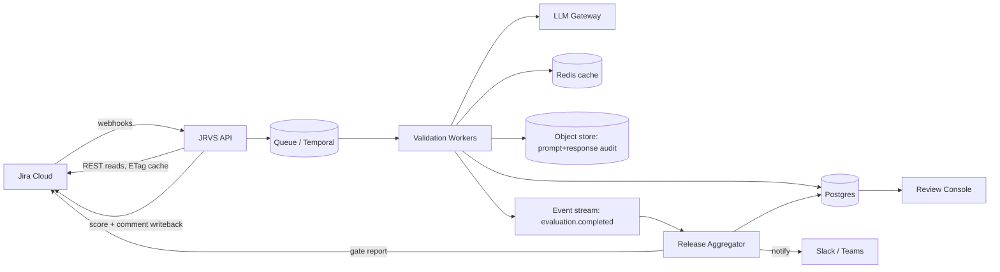
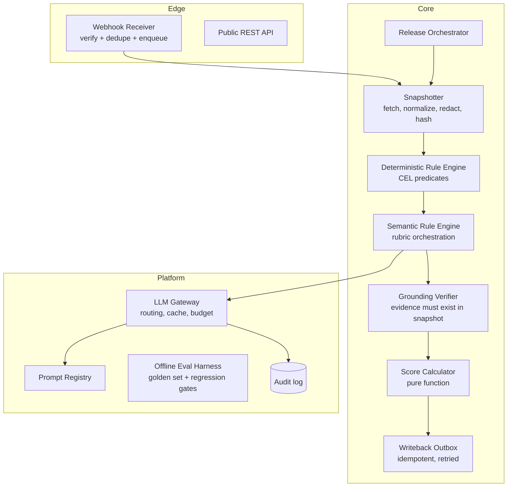
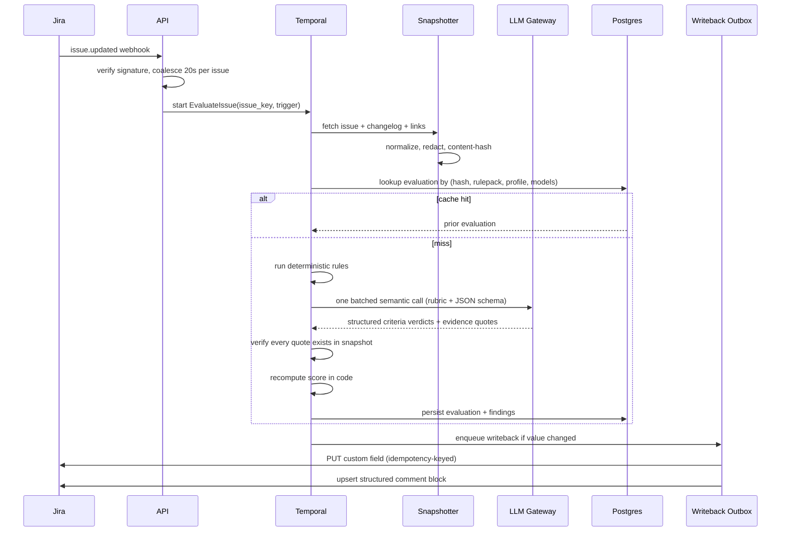

# JRVS — Jira Release Validation Service

**System Design · v0.1 draft · designed from scratch for this problem statement**

> This design was authored fresh for the stated goal. No existing product's architecture was used as a template.

---

## 1. Purpose

JRVS answers one question, continuously and defensibly:

> *"Is this Jira issue (and this release) described well enough to be worked on, verified, and shipped?"*

It reads Jira issues, evaluates them against a versioned rule pack, produces an explainable **0–100 Validation Score**, writes that score and a short breakdown back into Jira, and aggregates scores into release-level readiness gates.

The hard problem is not "call an LLM on a ticket". It is making a stochastic judge behave like a **stable, auditable, idempotent system of record** inside a workflow tool engineers already distrust. Everything below is shaped by that constraint.

---

## 2. Scope

### In scope
- Per-issue validation of fields, structure, and semantic quality.
- Deterministic + LLM-evaluated criteria in one unified score.
- Score write-back to Jira custom fields, with loop-proofing.
- Release-level aggregation, gate verdicts, waivers, and trend reporting.
- Full audit trail of what was judged, by which rule, model, and prompt version.

### Non-goals (v1)
- Auto-editing or auto-fixing issue content.
- Judging individual engineer performance (explicitly out of scope; the score belongs to the ticket, not the author).
- Replacing Jira workflow/transition automation.
- Free-form LLM text posted into Jira. Only structured, schema-validated output is ever written.
- Cross-project analytics beyond release-level rollups.

---

## 3. Design principles

| Principle | Consequence |
|---|---|
| **Deterministic where possible** | Anything checkable with code is checked with code. LLM is used only where meaning is required. |
| **The LLM proposes, the system decides** | Scores are computed in code from rule outcomes. No model output is ever the final number. |
| **Explain or don't score** | Every failed criterion carries an evidence quote or a concrete field reference. No evidence → `unknown`, not `fail`. |
| **Idempotent by construction** | Same issue snapshot + same rule pack + same model version = same score, and no duplicate write-backs. |
| **Version everything that changes judgement** | Rule packs, score profiles, prompts, and model routing are immutable and referenced by ID in every evaluation. |
| **Never punish with a zero** | Missing data, timeouts, and provider outages produce `unknown` + degraded confidence, never a failing score. |
| **Cheap by default** | One or two batched LLM calls per issue, aggressively cached. Cost is an architectural constraint, not an afterthought. |

---

## 4. Domain model

| Concept | Meaning |
|---|---|
| **Rule** | A single criterion, either `static` (predicate over issue JSON) or `semantic` (LLM rubric with structured output). |
| **Rule Pack** | Immutable, versioned set of rules scoped by project + issue type + (optional) status. |
| **Score Profile** | Immutable weighting + grade bands + gate thresholds. |
| **Snapshot** | Normalized, PII-redacted, content-hashed view of an issue at a point in time. |
| **Evaluation** | One immutable record: snapshot hash × rule pack version × score profile version × model routing version → findings, score, confidence. |
| **Finding** | `rule_id`, `status` (`pass` / `fail` / `unknown`), `severity` (`blocker` / `major` / `minor`), `message`, `evidence`, `suggested_fix`, `confidence`. |
| **Release Run** | Batch evaluation over all issues in a Jira version, producing a Readiness Report. |
| **Waiver** | Time-boxed, owner-attributed suppression of a specific failing rule on a specific issue. |

---

## 5. System context



---

## 6. Component architecture



**Runtime choices** (opinionated, replaceable):
- Python 3.12, FastAPI for the API, **Temporal** for all long-running/multi-step work (retries, release scans, backfills). Temporal gives durable per-issue workflows and removes hand-rolled retry state machines.
- Postgres 16 as the single source of truth (JSONB for findings). Redis for snapshot/ETag and LLM response caching.
- S3-compatible object store for immutable LLM prompt/response audit records (large blobs kept out of Postgres).

---

## 7. Issue evaluation lifecycle



### Loop prevention (critical)
1. Ignore webhooks whose changelog author is the JRVS service account **and** whose changed fields are only JRVS-owned fields.
2. Suppress write if `computed_score == stored_score` and `snapshot_hash == last_written_hash`.
3. Coalesce bursts: 20-second debounce per issue; a release scan supersedes queued per-issue jobs.
4. Only write to an explicit **field allowlist** configured per project; never touch fields owned by other automation.
5. Store `last_written_hash` + `last_written_at` in a Jira app property, so the service can restart without re-writing.

---

## 8. Rule engine

### 8.1 Static rules
Declarative predicates (CEL) evaluated against the normalized snapshot. Zero cost, sub-millisecond, fully deterministic.

```yaml
- id: SA-001
  kind: static
  severity: blocker
  weight: 3
  applies_to: { issue_types: [Story, Bug], statuses: ["Ready for Dev", "In Progress"] }
  when: "issue.fields.acceptance_criteria != null && size(issue.fields.acceptance_criteria) >= 1"
  message: "Story has no acceptance criteria."
  fix_hint: "Add at least one testable acceptance criterion."

- id: SA-014
  kind: static
  severity: major
  weight: 2
  when: "issue.fields.links.blocks.size() == 0 || issue.fields.links.blocks.all(l -> l.status != 'Open')"
  message: "Issue has no open blocking dependency recorded."
```

### 8.2 Semantic rules
LLM rubric with a fixed output contract. Example:

```yaml
- id: SE-003
  kind: semantic
  severity: major
  weight: 2.5
  rubric: acceptance_criteria_testability   # -> prompt template
  scale: [0, 0.5, 1]                        # fail / partial / pass
  requires_evidence: true
  max_input_tokens: 2500
```

**Batched semantic call.** All applicable semantic rules for one issue are sent in **one** request. The model returns a JSON object keyed by rule ID. Batching cuts cost ~4–6× versus per-rule calls and keeps criteria mutually consistent.

**Output contract** (enforced by JSON Schema + provider structured-output mode):

```json
{
  "SE-003": {
    "verdict": "partial",
    "confidence": 0.82,
    "evidence_quote": "Able to save the form",
    "rationale": "Criterion is observable but has no error or edge-case condition.",
    "suggested_fix": "Add a criterion covering validation failure and empty required fields."
  }
}
```

**Grounding verifier** (the anti-hallucination gate):
- `evidence_quote` must appear (normalized fuzzy match, ≥ 0.9 similarity, ≤ 400 chars) in the snapshot text.
- If the quote cannot be located → finding downgraded to `unknown`, `evidence_invalid = true`, and counted against confidence.
- `verdict: partial` is only accepted if the rubric explicitly supports partial credit.
- Any output that fails schema validation gets one "repair" retry; a second failure → `unknown` for that rule.

**Prompt-injection defense.** Issue text is untrusted input. The system prompt declares ticket content as data inside delimited blocks, the model has no tools, output is schema-constrained, and post-validation ignores any instruction-like content that does not map to a schema field.

### 8.3 Rule pack lifecycle
`draft → shadow → active → retired`, all immutable versions. A pack change triggers recomputation of only affected issues (by issue-type/status scope), never a full backfill by default.

---

## 9. LLM subsystem

| Concern | Design |
|---|---|
| **Provider abstraction** | `LLMGateway.complete(request)` — provider-agnostic; model routing table by task (`extraction`, `judgement`, `summarisation`). |
| **Determinism** | Temperature 0, fixed seed where supported, pinned model snapshot IDs (never `latest`). |
| **Caching** | Key = `sha256(content_hash + rule_pack_version + prompt_version + model_snapshot)`. Stored 30 days. Typical hit rate 35–60% on re-scans. |
| **Budget** | Per-tenant daily token budget, per-issue token ceiling, hard fail-closed to `unknown` (never to a score of 0). |
| **Prompt registry** | Prompts stored in Git, versioned, loaded at boot, referenced by hash in every evaluation. No prompt edits in the database. |
| **Offline evals** | Golden set of ~500 human-labelled tickets per rule family. CI gate: a prompt/model change must not drop per-rule F1 by >2 points or raise cost/issue by >15%. |
| **Drift detection** | Weekly shadow re-score on a fixed sample; alert if score distribution shifts > 8 points or `unknown` rate rises > 5%. |
| **Audit** | Every call persisted with request hash, model, tokens, latency, prompt version, and response body (retention 400 days, redacted). |

---

## 10. Scoring model

### 10.1 Formula

For applicable rules *i* with weight *wᵢ* and outcome *oᵢ* ∈ [0,1]:

```
resolved   = rules whose status is pass or fail          (unknown excluded from denominator)
coverage   = Σ wᵢ over resolved / Σ wᵢ over applicable
raw        = Σ_{resolved} wᵢ · oᵢ  /  Σ_{resolved} wᵢ
raw        = min(raw, 0.49)  if any blocker rule failed
score      = round(100 · raw)
confidence = 0.6 · coverage + 0.4 · (grounded evidence rate)
```

`score` is a pure function of findings — reproducible offline, unit-testable, and independent of the model that produced the findings.

### 10.2 Grades

| Score | Grade | Meaning |
|---|---|---|
| 90–100 | **Excellent** | Ship-ready as written. |
| 75–89 | **Ready** | Minor gaps only. |
| 60–74 | **Needs work** | Major gaps; not gate-eligible. |
| 0–59 | **Blocked** | Blocker present or pervasive gaps. |
| — | **Unverified** | `confidence < 0.65`. Shown as a badge, never as a passing score. |

### 10.3 Release gate

A release passes when **all** hold:
- zero open `blocker` findings across in-scope issues,
- mean score ≥ gate threshold (default 75),
- 10th-percentile score ≥ 55 (prevents "great average, terrible tail"),
- unverified issues ≤ 5% of scope,
- every failure covered by an **active, unexpired, owner-attributed waiver**.

Waivers expire automatically (max 30 days) and are listed in the report with owner and reason.

### 10.4 Worked example

| Rule | Weight | Outcome | Contribution |
|---|---|---|---|
| SA-001 AC present | 3 | 1.0 | 3.0 |
| SA-014 Dependency recorded | 2 | 0.0 | 0.0 |
| SE-003 AC testability | 2.5 | 0.5 | 1.25 |
| SE-007 Description clarity | 1.5 | 1.0 | 1.5 |
| SE-011 Repro steps (Bug only) | 2 | unknown | excluded |

`raw = 5.75 / 9.0 = 0.639` → **64 · Needs work**. Coverage `= 9/11 = 0.82`; grounded evidence rate `1.0` → confidence `0.89`.

---

## 11. Write-back to Jira

| Field | Type | Written when |
|---|---|---|
| `Validation Score` | number (0–100) | value changed |
| `Validation Grade` | select | grade band changed |
| `Validation Confidence` | number | value changed |
| Validation comment | structured ADF block | breakdown changed by > 5 points, or grade changed |
| Label `jrvs:blocked` | label | blocker present / cleared |

Comment is a **single upserted block** (located by a hidden marker), not a new comment per evaluation — this prevents comment spam, which is the fastest way to get a tool uninstalled.

Outbox record: `{evaluation_id, issue_key, field, value, idempotency_key}`, at-least-once delivery with Jira `429`/`5xx` retry (respect `Retry-After`, exponential backoff, circuit breaker). Duplicate delivery is harmless because writes are value-equality guarded.

---

## 12. Release validation

1. Operator (or schedule) requests `POST /v1/releases/{project}/{version}/validate` with a scope selector.
2. Orchestrator pages through JQL (`fixVersion = X AND issuetype in (...)`), creating child workflows with a concurrency cap (default 8 in-flight per tenant).
3. Each child reuses cached evaluations where the snapshot hash is unchanged.
4. Aggregator computes: gate verdict, score distribution, top failing rules, blocker list, coverage/confidence, delta vs previous run, waiver list.
5. Report persisted and posted to the release page / Slack; a signed JSON snapshot is downloadable.

Runs are recorded as immutable reports so "the release passed on Tuesday" is always provable.

---

## 13. Data model (core tables)

```sql
projects(id, tenant_id, jira_project_key, field_map jsonb, settings jsonb)
rule_packs(id, project_id, version, scope jsonb, status, created_by, created_at)
rules(id, rule_pack_id, rule_key, kind, severity, weight, spec jsonb)
score_profiles(id, project_id, version, weights jsonb, grade_bands jsonb, gate jsonb)
snapshots(id, issue_key, content_hash, payload jsonb, redaction_report jsonb, captured_at)
evaluations(id, issue_key, snapshot_id, rule_pack_id, score_profile_id,
            model_routing_id, prompt_versions jsonb, score int, grade text,
            confidence numeric, findings jsonb, cost_usd numeric, latency_ms int,
            created_at)
latest_evaluations(issue_key PK, evaluation_id, score, grade, updated_at)
releases(id, project_id, jira_version, state)
release_runs(id, release_id, scope jsonb, verdict, report jsonb, started_at, finished_at)
waivers(id, issue_key, rule_key, owner, reason, expires_at, revoked_at)
writebacks(id, evaluation_id, issue_key, field, value, idempotency_key,
           state, attempts, last_error)
llm_calls(id, evaluation_id, provider, model, prompt_version, input_hash,
          tokens_in, tokens_out, latency_ms, response_ref, created_at)
```

Indexes that matter: `evaluations(issue_key, created_at desc)`, `latest_evaluations(score)`, GIN on `findings`, and `writebacks(state, next_attempt_at)`.

---

## 14. API surface

```
POST /v1/issues/{key}/evaluate          -> 202 {evaluation_id}
GET  /v1/issues/{key}/evaluation        -> latest evaluation + findings
GET  /v1/issues/{key}/history?limit=50  -> score trend
POST /v1/releases/{project}/{version}/validate -> 202 {run_id}
GET  /v1/releases/runs/{run_id}         -> report (or 202 while running)
POST /v1/waivers                        -> create waiver (requires owner + reason + expiry)
DELETE /v1/waivers/{id}                 -> revoke
POST /v1/rule-packs                     -> create draft
POST /v1/rule-packs/{id}/activate       -> promote (runs shadow comparison first)
GET  /v1/health, /v1/metrics
```

Every write endpoint requires an idempotency key. Every read endpoint returns the full provenance tuple stored on the evaluation.

---

## 15. Non-functional requirements

| Area | Target |
|---|---|
| Single-issue evaluation p95 | ≤ 6 s (LLM path), ≤ 400 ms (cache hit) |
| Release scan, 500 issues | ≤ 10 min at default concurrency |
| Webhook→field updated p95 | ≤ 8 s |
| Availability | 99.5% API, 99.9% writeback eventual delivery within 15 min |
| Throughput | 50 evaluations/s sustained, 300/s burst (coalesced) |
| Data retention | evaluations 2 years, LLM audit 400 days (configurable) |

---

## 16. Failure modes & degradation

| Failure | Behaviour |
|---|---|
| LLM provider down / timeout | Deterministic-only score, grade prefixed with `partial`, confidence reduced, `unknown` for semantic rules. Never a 0. |
| LLM returns invalid JSON twice | Affected rules `unknown`; issue marked `unverified` if coverage < 0.65. |
| Jira rate-limited | Queue with `Retry-After`; writeback delayed, evaluation still persisted. |
| Issue changed during evaluation | Snapshot-hash mismatch on write; abort write, re-enqueue with fresh snapshot. |
| Duplicate webhooks | Deduped by `(issue_key, updated_at, trigger)` in Redis, 10-minute TTL. |
| Prompt regression | Offline eval gate blocks deploy; runtime drift alarm triggers automatic rollback of the routing table to the previous pinned model. |

---

## 17. Security & compliance

- **Auth to Jira**: OAuth 2.0 3LO, scopes limited to `read:jira-work`, `write:jira-work`. Tokens encrypted with KMS envelope encryption; refresh handled centrally.
- **Tenant isolation**: every row carries `tenant_id`; Postgres row-level security; per-tenant KMS keys.
- **Redaction before LLM**: emails, phone numbers, tokens, URLs to internal systems, and attachment contents are stripped or replaced. Redaction report stored with the snapshot.
- **Data handling**: LLM calls use zero-retention endpoints where available; provider configured to not train on inputs; region pinned to tenant residency.
- **Write safety**: field allowlist, dry-run mode per project, and a kill switch that disables all write-backs without stopping evaluation.
- **Audit**: every score change traceable to snapshot, rules, prompt, model, and code version.

---

## 18. Observability & cost

**Metrics**: evaluations/min, cache hit rate, `unknown` rate, per-rule fail rate, score distribution, writeback lag, LLM tokens/issue, $/issue, evidence-validation failure rate, gate pass rate.

**Traces**: one trace per issue evaluation with spans for fetch, deterministic rules, LLM call, grounding, scoring, writeback.

**Alerts** (page-worthy): writeback lag > 30 min, evidence-validation failure > 5%, `unknown` rate > 20%, score distribution shift > 8 points week-over-week, LLM spend > 120% of budget.

**Cost shape**: ~1.5k input + ~400 output tokens per issue on the judgement model, one call. At 20k evaluations/day this is in the low tens of dollars per day (illustrative); deterministic rules and cache carry the rest for free. Cost per evaluation is tracked as a first-class metric and is part of the prompt-change CI gate.

---

## 19. Deployment & scaling

- Single container image, three processes: `api`, `worker`, `scheduler`; deployed on Kubernetes with HPA on Temporal task-queue backlog.
- Stateless workers; all state in Postgres/Redis/S3.
- Postgres: primary + read replica; partition `evaluations` and `llm_calls` monthly.
- Multi-region: active-passive per tenant residency region; Jira webhooks routed by tenant.
- Zero-downtime deploys; Temporal workflows survive rollout (no lost evaluations mid-flight).

---

## 20. Test strategy

| Layer | Approach |
|---|---|
| Score calculator | Property-based tests: monotonicity (raising any outcome never lowers score), blocker cap, `unknown` exclusion. |
| Rule packs | Fixture issues with expected findings; every rule needs ≥ 1 positive and ≥ 1 negative fixture. |
| Grounding verifier | Adversarial cases: paraphrased quotes, quotes from other tickets, injected instructions. |
| LLM behaviour | Golden set with per-rule precision/recall/F1 thresholds in CI. |
| Integration | Jira sandbox with webhook replay; assert no duplicate comment writes across retries. |
| Load | Replay 30 days of real webhook traffic at 3× rate. |

---

## 21. Key decisions

| # | Decision | Alternatives considered | Why |
|---|---|---|---|
| D1 | Score computed in code from findings | Let the LLM emit the score | Reproducibility, testability, explainability, provider portability |
| D2 | One batched semantic call per issue | One call per semantic rule | 4–6× cheaper, mutually consistent criteria, fewer rate-limit failures |
| D3 | Immutable rule packs + profiles | Mutable "current settings" row | Historic scores must remain explainable after policy changes |
| D4 | Upserted structured comment instead of new comment per run | Append comment per evaluation | Prevents notification spam and Jira clutter |
| D5 | Temporal for orchestration | Celery + custom retry tables | Durable workflows, replay, no bespoke state machine for release scans |
| D6 | `unknown` instead of `fail` on missing evidence | Fail closed | Avoids penalising tickets for infrastructure faults |

---

## 22. Assumptions & open questions

**Assumptions**
- Jira Cloud with webhooks and custom fields available; one service account per tenant.
- Semantic evaluation of ticket text is acceptable under the organisation's data policy.
- A human owns the rule pack per project; JRVS does not invent policy.

**Open questions**
1. Should the score be visible to all users or restricted to leads? (Affects field-level visibility and gaming risk.)
2. Do we allow "score override" with justification, and how does that interact with gate history?
3. Is a per-issue score needed for Epics/Sub-tasks, or only Stories/Bugs?
4. Which fields are legitimately project-specific enough to require per-project rule packs in v1?

---

## 23. Roadmap

| Phase | Deliverable |
|---|---|
| **P0 (4–6 wks)** | Webhook ingest, snapshotting, static rules, write-back outbox, shadow mode, score calculator. |
| **P1** | Semantic rules + grounding verifier, prompt registry, offline eval harness, review console read-only. |
| **P2** | Release aggregation + gate report, waivers, trend dashboards. |
| **P3** | Rule-pack authoring UI, per-project tuning, drift auto-rollback, optional self-hosted model routing. |
