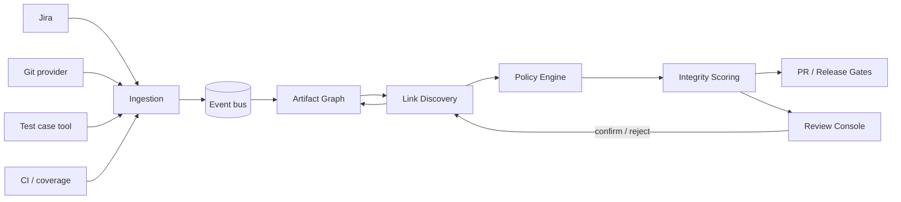
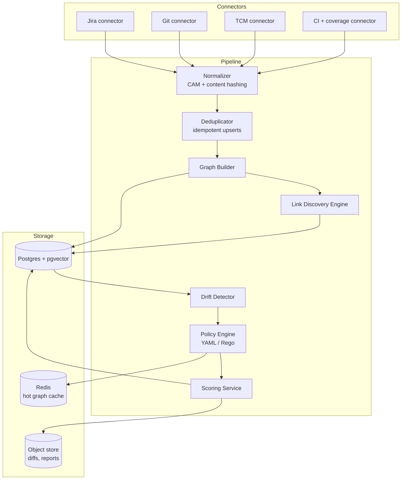
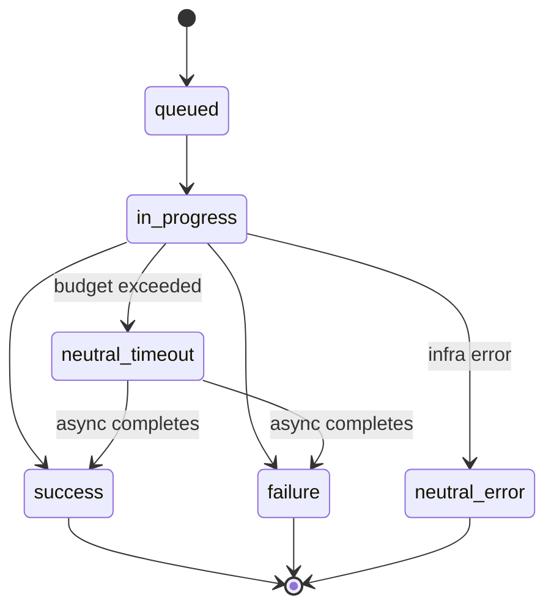
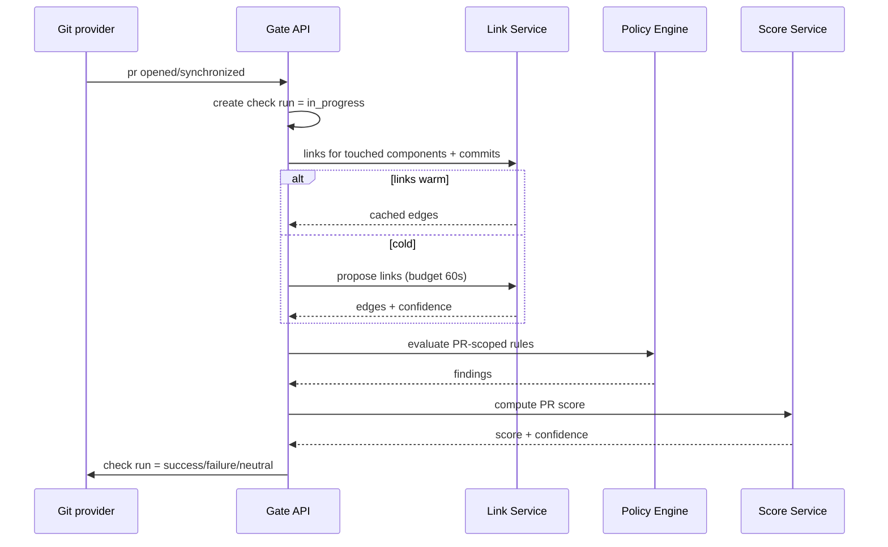
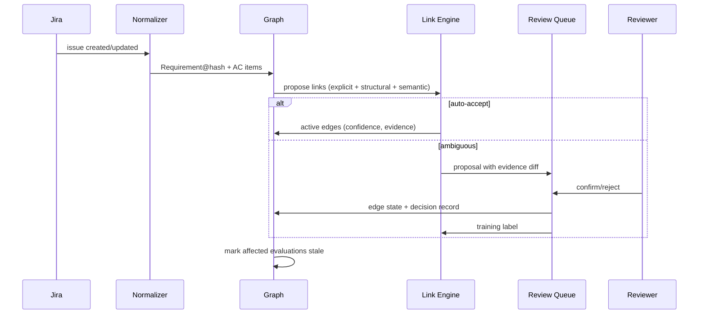
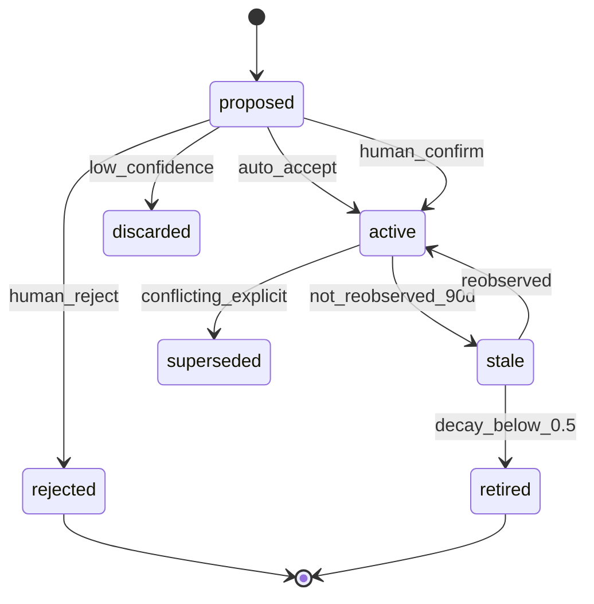

# OPTIMUS — Cross-Artifact Validation System

**System Design · v0.2 · designed from scratch for this problem statement**

> This design was authored fresh for the stated goal. No existing product's architecture was used as a template.

---

## 1. Purpose

OPTIMUS answers one question, continuously and for every release:

> *"Do the Jira requirement, the committed code, and the test cases actually describe, implement, and verify the same thing?"*

It ingests three independent systems of record — **Jira**, **Git**, and a **test case maintenance tool (TCM)** — builds a single provenance-aware graph of artifacts, discovers and scores the links between them, and evaluates the graph against versioned policies. The output is an explainable **Integrity Score** plus actionable findings, delivered as a PR check, a release gate, and a dashboard.

The hard problem is not integration. It is that the three systems do not share identifiers, teams edit them at different times, and "linked" is a matter of degree. OPTIMUS is therefore built around a **confidence-bearing link graph** and a **human-confirmed feedback loop**, not around brittle key matching alone.

### Success criteria for the tool itself

| Goal | Measure | Target at 90 days |
|---|---|---|
| Links are trustworthy | Precision of auto-accepted links (weekly sample of 200) | ≥ 0.95 |
| Links are useful | % of in-scope requirements with ≥ 1 verified test | ≥ 85% |
| Gates are fast | PR check p95 | ≤ 60 s |
| Findings are actionable | Findings with artifact + evidence + fix | 100% |
| Drift is caught | Stale tests detected before release (vs. found after) | ≥ 90% |
| Noise is low | Advisory findings dismissed as "not useful" | ≤ 10% |
| Coverage of truth | Releases passing with link-confidence mass < 0.8 | 0 |

---

## 2. Scope

### In scope
- Read-only ingestion from Jira, Git providers, TCM, CI results, and coverage reports.
- Canonical normalization of requirements, code changes, test cases, and executions.
- Explicit, structural, semantic, and behavioural link discovery.
- Drift detection when a requirement changes but its tests or code do not.
- Policy evaluation over the graph: linkage, freshness, execution evidence, AC coverage, code–test alignment.
- PR-level checks and release-level readiness gates, with waivers and audit history.
- Human review console for ambiguous links and policy exceptions.
- Precision auditing as a built-in, scheduled workflow.

### Non-goals (v1)
- Running tests, owning CI, or acting as a test orchestrator.
- Automatic code modification or test generation.
- Replacing Jira or the TCM; OPTIMUS stores only references and derived state.
- Auto-linking without approval. Inference is always *proposed*; only explicit or human-confirmed links are treated as facts.
- Judging individual developer productivity. Scores attach to releases, components, and artifacts — never to people.
- Analysing binary artifacts, infrastructure state, or runtime traces.

---

## 3. Design principles

| Principle | Consequence |
|---|---|
| **Provenance over assumption** | Every edge knows how it was created, by whom, with what confidence, and from which evidence. |
| **Explicit beats inferred** | Precedence is fixed: confirmed > explicit > structural > behavioural > semantic. Conflicts are findings, not silent overrides. |
| **Confidence is a first-class field** | A link without a confidence value is invalid. Scores propagate link confidence instead of hiding it. |
| **Incremental by default** | A change recomputes only the affected subgraph. Full backfills are explicit operations with quotas. |
| **Explainable failures only** | A failing rule names the artifact, the evidence, and one concrete next action. |
| **Advisory before blocking** | Every new policy ships in shadow → advisory → gating mode. |
| **Code stays where it is** | Source code is analysed in-place/on-prem; only derived facts and, where permitted, signatures/AST summaries leave the boundary. |
| **Unknown is not green** | A gate that cannot establish truth reports `neutral` or fails the confidence floor. It never passes by default. |

---

## 4. Canonical artifact model (CAM)

Every source is normalized into one schema so that policies never branch on vendor.

| Artifact | Key fields |
|---|---|
| `Requirement` | source, external_id, project, type, title, description, **acceptance_criteria[]** (each with stable `ac_id`), status, fix_version, component, updated_at, content_hash |
| `AcceptanceCriterion` | `ac_id` (hash of normalized text), requirement_id, text, ordinal, status |
| `CodeChange` | repo, commit_sha, parents[], author, message, branch, files[{path, additions, deletions, patch_ref}], pr_id, merged_at |
| `CodeSymbol` | repo, symbol_path, kind, signature_hash, owning_component, last_changed_sha |
| `TestCase` | source, external_id, title, preconditions, steps[], expected, priority, suite, component, jira_refs[], updated_at, content_hash, state(active/draft/deprecated) |
| `TestRun` | test_case_id, build_id, status, duration, failure_signature, executed_at, commit_sha |
| `CoverageMap` | commit_sha, test_file → source_file[] (from CI coverage instrumentation) |
| `Release` | project, version, scope (issue JQL equivalent), branch, cutoff |

**Normalization rules.** Text is NFC-normalized, whitespace-collapsed, and stripped of boilerplate ("As a user…"). Acceptance criteria are parsed into discrete items so that each one can carry its own `ac_id` and its own links — this is what makes drift detection precise instead of "the ticket changed".

### 4.1 CAM example

```json
{
  "kind": "Requirement",
  "source": "jira",
  "external_id": "ABC-123",
  "content_hash": "9b1e…",
  "project": "ABC",
  "type": "Story",
  "title": "Export quarterly revenue report as CSV",
  "acceptance_criteria": [
    { "ac_id": "a1f0c7", "ordinal": 1, "text": "Clicking Export downloads a CSV within 5 seconds." },
    { "ac_id": "b2c19d", "ordinal": 2, "text": "CSV contains only rows in the selected date range." },
    { "ac_id": "c3d2e8", "ordinal": 3, "text": "Empty range shows a validation message and downloads nothing." }
  ],
  "fix_version": "2026.10",
  "component": "Reporting",
  "status": "In Progress",
  "updated_at": "2026-10-04T16:08:00Z"
}
```

### 4.2 Acceptance criteria parsing

Ordered heuristics, each result recorded so parsing is auditable:

1. **Structured field** — Jira custom field / TCM field with discrete items (best).
2. **Markdown/ADF lists** — list items under a heading matching `/acceptance criteria|AC|definition of done/i`.
3. **Given/When/Then** — regex segmentation into scenarios, split on repeated `Given`.
4. **Sentence fallback** — split on `;` or newline where each fragment contains a modal (`must|should|can|shall`).
5. **LLM extraction** — only if 1–4 fail; output verified by requiring each extracted item to appear verbatim in the requirement text. Unverifiable items are discarded.

`ac_id = sha256(project + normalize(text))[:6]`, so an unchanged criterion keeps its identity across edits — the prerequisite for "AC #2 changed" rather than "the ticket changed".

---

## 5. System context



**Trust boundaries.** Source systems are untrusted inputs (commit messages and test steps are attacker-influenced text). The link engine must therefore never let text alone create a fact-level edge, and the gate must never accept an unverified chain. Source code is a *restricted* data class with its own egress rules (§18).

---

## 6. Component architecture



**Runtime choices.**
- Python/Go services; **Temporal** for connector-backfill, link recompute, and release scans; Kafka (or Redis Streams for a smaller install) for ingestion events.
- Postgres as the system of record, with **pgvector** for candidate retrieval. A dedicated graph database is deliberately avoided in v1 — recursive CTEs over an indexed edge table handle the subgraphs we need, and one fewer stateful store is one fewer consistency problem. Introduce a graph DB only if traversal depth or query latency proves it.
- Object storage for diffs, JUnit XML, coverage maps, and immutable evaluation reports.
- **ClickHouse** (or partitioned Postgres) for `test_executions` once volume exceeds ~5M rows/day; abstracted behind a `TestExecutionStore` interface so the migration is contained.

### 6.1 Component responsibilities

| Component | Owns | Must never |
|---|---|---|
| Connectors | Auth, cursors, raw capture, webhook verification | Interpret semantics |
| Normalizer | CAM mapping, hashing, dedupe keys | Invent missing fields (uses explicit `unknown`) |
| Graph Builder | Version rows, base edges, change propagation | Compute confidence |
| Link Engine | Candidate generation, ranking, edge lifecycle | Write to source systems |
| Drift Detector | AC-level diffs, change classification | Alert on L0 cosmetic edits |
| Policy Engine | Rule evaluation, severity, waivers | Compute the score |
| Scoring Service | Dimension aggregation, confidence | Re-run policies |
| Gate API | Check-run lifecycle, timeouts | Block on its own outage |
| Review Console | Human decisions, explanations | Auto-accept on behalf of a human |

---

## 7. Ingestion

| Source | Mechanism | Latency target |
|---|---|---|
| Jira | Webhooks (issue create/update/delete, link events) + scheduled reconcile every 6 h | < 60 s |
| Git | Provider webhooks (push, PR merged) + API backfill for history; no polling in steady state | < 60 s |
| TCM | Webhooks where available; otherwise delta polling on `updated_at` every 5 min | < 5 min |
| CI | Post-build webhook with JUnit + coverage artifacts | < 2 min |

**Exactly-once effects, at-least-once delivery.** Each event carries `(source, source_event_id)`. The normalizer computes `content_hash` per artifact; upserts are keyed by `(source, external_id, content_hash)`, so replays are no-ops and only genuinely new versions create rows. Unparseable events go to a DLQ with the raw payload retained for 14 days.

**Change propagation.** When an artifact version is written, the graph builder enqueues a recompute for the reverse-reachable set (depth ≤ 2, capped at 5,000 nodes, debounced 60 s). Requirement edits therefore re-evaluate only the tests and commits that could plausibly be affected — not the release.

**History, not overwrite.** Artifact versions are append-only. `Requirement@hash`, `TestCase@hash` are immutable rows; "current" is a view. This is what makes drift detection and "who changed what when" possible.

### 7.1 Event envelope

```json
{
  "specversion": "1.0",
  "id": "01J9ZK4T7Q",
  "source": "connector.git",
  "type": "com.optimus.artifact.code_change.v1",
  "subject": "repo:payments-api#9f2c1a",
  "time": "2026-10-04T16:08:00Z",
  "tenant": "acme",
  "content_hash": "9f2c1a…",
  "data": {
    "repo": "payments-api",
    "commit_sha": "9f2c1a…",
    "parents": ["3a7d…"],
    "branch": "release/2026.10",
    "pr_id": 812,
    "message": "ABC-123 add CSV export endpoint",
    "files": [{ "path": "src/reporting/export.ts", "additions": 84, "deletions": 2 }],
    "patch_ref": "s3://optimus-diffs/acme/payments-api/9f2c1a.patch"
  }
}
```

Idempotency key = `(type, subject, content_hash)`. The consumer treats a duplicate as success, never as a conflict.

### 7.2 Connector contract

Every connector implements four operations, which keeps vendor code out of the pipeline:

```python
class Connector(Protocol):
    def backfill(self, cursor: Cursor | None, until: datetime, quota: Quota) -> Iterator[Event]: ...
    def poll(self, cursor: Cursor) -> PollResult            # delta only
    def verify_webhook(self, headers, body) -> Event | None # raises on invalid signature
    def reauth(self) -> Credential                         # refresh, tenant-scoped
```

**Quotas** are mandatory: each connector declares `max_requests_per_minute`, `max_backfill_days_per_run`, and a checkpoint cadence, so a single connector cannot starve the others.

### 7.3 Backfill and reconciliation

- **Backfill** is a Temporal workflow with windowed pagination (default 7-day windows), resumable from a cursor, rate-limited, and cancellable.
- **Reconcile** runs every 6 h and compares source-side `updated_at` watermarks with local maxima. Divergence enqueues targeted re-fetches (5-minute cap per run) and raises `SYNC_DRIFT` if it persists for two cycles.
- **Watermarks** are recorded on every evaluation report so a gate can say exactly how fresh its inputs were.

---

## 8. Link discovery engine

The core of OPTIMUS. Links are typed edges between artifacts:

```
Requirement --references--> CodeChange
Requirement --verifies-----> TestCase      (test case verifies requirement)
CodeChange  --touches------> CodeSymbol
CodeSymbol  --covered_by---> TestCase      (derived from coverage + test code)
TestCase    --executed_in--> TestRun
```

Every edge carries `origin ∈ {confirmed, explicit, structural, behavioural, semantic}`, `confidence ∈ [0,1]`, `evidence[]`, `state ∈ {proposed, active, rejected, stale}`.

### 8.1 Cascade

1. **Explicit (confidence 1.0).** Jira key regex in commit message / branch name / PR title; `jira_refs` field in the test case; commit SHA referenced in a test case or test annotation (`@Jira("ABC-123")`).
2. **Structural (0.6–0.85).** Repo↔Jira project mapping, CODEOWNERS/component ownership, fix-version↔release-branch mapping, suite↔component mapping. Links artifacts that share an owner but no key.
3. **Behavioural (0.7–0.9).** Coverage map joins test files to source files; source files are joined to the requirement through commits. This catches "the test verifies this code, and this code implements this story" even with no textual clue.
4. **Semantic (0.3–0.95).** Embedding retrieval + rerank between AC items and test cases (title + steps + expected), and between AC items and code symbols (docstrings/signatures). Candidates retrieved via pgvector ANN; reranked by a gradient-boosted ranker using features below.

### 8.2 Ranker features

| Feature | Type | Notes |
|---|---|---|
| `explicit_key_match` | bool | Jira key in message/branch/PR/tcm refs |
| `component_match` | bool | Shared component between requirement and test/symbol |
| `path_token_overlap` | 0–1 | Tokens shared by changed paths and component/test names |
| `embedding_cosine` | 0–1 | AC text vs test title+steps (or symbol docstring) |
| `identifier_overlap` | 0–1 | Camel/snake tokens shared between AC and code symbols |
| `same_sprint` | bool | Requirement and test changed within the same sprint window |
| `team_prior` | 0–1 | Historical accept rate for this repo↔suite pair |
| `test_recency` | 0–1 | Whether the test was updated near the requirement change |
| `signal_count` | int | Number of independent signal families agreeing |

`signal_count` is not a model feature only — it is a **decision gate** (see §8.3), which prevents a single over-weighted feature from auto-accepting a link.

### 8.3 Decision policy

```
auto_accept   : confidence >= 0.85 AND independent_signal_count >= 2
review_queue  : 0.55 <= confidence < 0.85
discard       : confidence < 0.55
```

- **Multiple independent signals** means, for example, key match *and* shared component — not two flavours of the same text similarity.
- **Precedence on conflict:** confirmed > explicit > structural > behavioural > semantic. If two explicit links contradict (ticket says X, commit says Y), a `LINK_CONFLICT` finding is raised rather than picking a winner.
- **Human decisions are durable.** A confirmed link becomes `origin: confirmed`, confidence 1.0, and is never downgraded by the model. A rejection suppresses the exact pair for 180 days and is fed back as a negative label.
- **Staleness of inferred edges** is explicit: an inferred edge not re-observed for 90 days decays by 0.1/month and is retired below 0.5, unless confirmed.

### 8.4 Learning loop
Human confirmations/rejections accumulate per project into a labelled dataset. A per-project re-ranker is retrained weekly once ≥500 decisions exist; until then a global ranker is used. Rollout is shadow-scored against live proposals; a new ranker is promoted only if precision at the auto-accept threshold improves and recall does not drop by more than 2 points.

### 8.5 Graph queries the product needs

| Query | Purpose | Shape |
|---|---|---|
| `tests_for(requirement)` | Coverage, drift | 1 hop over `verifies` |
| `requirements_for(commit)` | PR gate, orphan detection | 1–2 hops with origin filter |
| `stale_tests(release)` | Drift gate | join requirement versions × edges × test versions |
| `orphans(release_branch)` | Linkage rule | left-join code changes with no active requirement edge |
| `impact(requirement)` | Change propagation | reverse traversal, depth ≤ 2 |
| `duplicate_requirements()` | Duplicate rule | ANN over embeddings ≥ 0.95 |

Example: orphan commits in a release, using a recursive CTE over indexed edges:

```sql
WITH reachable AS (
  SELECT e.src_id AS commit_id
  FROM artifact_edges e
  JOIN artifacts a ON a.id = e.src_id AND a.kind = 'CodeChange'
  WHERE e.kind IN ('references','implements') AND e.state = 'active'
)
SELECT c.*
FROM code_changes c
JOIN artifacts a ON a.id = c.artifact_id
LEFT JOIN reachable r ON r.commit_id = c.artifact_id
WHERE a.branch = 'release/2026.10' AND r.commit_id IS NULL;
```

### 8.6 Monorepos and multi-key commits

- A commit touching N components with one Jira key produces one explicit edge to that requirement plus **structural candidates** for the other components' requirements — never N auto-accepted links.
- If a commit's message contains multiple keys, each is explicit; if the diff contains no path in the corresponding component, the edge is created but flagged `WEAK_REFERENCE` and excluded from coverage evidence until confirmed.
- Path→component mapping is configuration (`component_map` in the repo record), derived initially from CODEOWNERS and refined by humans.

---

## 9. Drift detection

The failure mode OPTIMUS exists to catch: *a requirement changed, the tests did not.*

1. Each AC item has a stable `ac_id`. On requirement update, the detector diffs AC items into `added / removed / modified`.
2. Each change is **classified** so teams are not spammed by typos:
   - **L0 cosmetic** — whitespace, grammar, no semantic delta. No action.
   - **L1 clarifying** — wording clarified, behaviour unchanged. Notification only.
   - **L2 behavioural** — new or changed behaviour/edge case. Requires an updated or explicitly waived test.
3. For every L2 change, the detector walks `Requirement → TestCase` edges and checks whether linked tests were updated **at or after** the requirement's change time.
4. Result: `TEST_STALE` findings per AC item, distinguish "no test at all" from "test exists but predates the change".

### 9.1 Diff algorithm

```
new_items = [i for i in requirement.acceptance_criteria]
old_items = [i for i in previous_version.acceptance_criteria]

matched = optimal_alignment(old_items, new_items,
                            key=ac_id, fallback=semantic_similarity >= 0.9)
modified = pairs where text differs beyond normalization
added    = new_items - matched
removed  = old_items - matched

for change in modified|added:
    level = classify(change)
    if level == L2:
        tests = tests_verifying(ac_id=change.ac_id)
        stale = [t for t in tests if t.updated_at < change.detected_at]
        emit TEST_STALE or TEST_MISSING
```

`optimal_alignment` is a best-match assignment over (id exact, then embedding similarity) so that reordering AC items does not create false "removed + added" pairs.

### 9.2 Change classification

| Level | Detection | Action |
|---|---|---|
| L0 cosmetic | Normalized text identical after stripping punctuation/case; or embedding cosine ≥ 0.99 | Record only |
| L1 clarifying | Cosine 0.90–0.99 and LLM diff returns no new/removed behaviour claim | Console note, no gate effect |
| L2 behavioural | New modal/condition/threshold; LLM diff returns added/removed behaviour; new AC item | Requires test update or waiver |

Classification output is structured, never prose:

```json
{
  "level": "L2",
  "added_behaviour": ["validation message for empty date range"],
  "removed_behaviour": [],
  "confidence": 0.91
}
```

A test is **stale** if `test.updated_at < requirement_version.updated_at` *and* the change is L2. A test is **missing** if the AC item has no active verifying link. These are different findings with different severities — the distinction is what makes the output trustworthy.

### 9.3 Anti-noise measures

- L0/L1 never notify; they appear only in the requirement timeline.
- Repeated identical L2 changes within a sprint window collapse into one finding.
- A stale test appears once per (requirement, test) pair, not once per AC item; the finding lists affected `ac_id`s.
- Findings auto-close when a later test version satisfies the condition — no manual bookkeeping.

---

## 10. Policy engine

Policies are versioned, per-project, and written as code (YAML with an embedded expression language, or Rego for complex cases). Each rule evaluates against the graph and returns findings; the score is computed from findings in code.

```yaml
policy: release-integrity
version: 7
rules:
  - id: LNK-001
    severity: blocker
    weight: 3
    assert: every_in_scope_requirement has_active_link to code
    message: "Requirement is not implemented by any merged commit in this release."

  - id: LNK-004
    severity: major
    weight: 2
    assert: no orphan_commit in release_branch
    message: "Commit is not linked to any requirement."

  - id: DRF-002
    severity: blocker
    weight: 3
    assert: for_each L2_change, all_verifying_tests.updated_at >= change.at
    message: "Acceptance criterion changed after its tests were last updated."

  - id: EXE-001
    severity: major
    weight: 2
    assert: last_3_builds.test_pass_rate >= 0.95
    message: "Linked tests are not passing in recent builds."

  - id: COV-003
    severity: major
    weight: 2
    risk_weighted: true
    assert: ac_coverage_ratio >= 0.90
    message: "Risk-weighted acceptance criterion coverage below threshold."

  - id: INT-001
    severity: minor
    weight: 1
    assert: test_case.assertion_count_delta >= 0
    message: "Assertions were removed from a linked test in the same commit as source changes."
```

### 10.1 Rule grammar

```
rule        := id, severity, weight, assert, message, [scope], [waivable]
assert      := quantified_predicate
quantified  := ("every" | "no" | "any" | "for_each") subject [where predicate]
subject     := requirement | code_change | test_case | test_run | ac_item
predicate   := comparison | membership | temporal | graph_traversal
temporal    := field ("<" | "<=" | ">" | ">=") (field | duration_literal)
```

Rules are total functions over the snapshot graph: no I/O, no randomness, no wall-clock access (time is injected from the evaluation watermark). This makes a report reproducible from its `inputs_hash`.

### 10.2 Evaluation semantics

- **Scope** limits which artifacts a rule sees (`project`, `component`, `release`); out-of-scope artifacts are not counted as failures.
- **Inapplicable** ≠ **pass**: if input data is missing, the rule yields `unknown` and reduces confidence rather than inflating the score.
- **Severity resolution**: `blocker` fails the release; `major` requires waiver; `minor` is report-only.
- **Waivers** require owner, reason, expiry (≤ 30 days), and appear in every gate report. A waived blocker yields `FAIL_WAIVED`, which is visibly different from `PASS`.

---

## 11. Scores and gates

### 11.1 Integrity score

```
dimensions = {
  linkage      : 0.25,
  ac_coverage  : 0.25,
  execution    : 0.20,
  freshness    : 0.15,
  code_test    : 0.15
}

dimension_score = Σ wᵣ·oᵣ / Σ wᵣ            (oᵣ ∈ [0,1], unknown excluded)
integrity       = 100 · Σ Wd · dimension_score_d
confidence      = weighted mean of link confidence over all edges used
```

Grade bands: **90–100 Verified**, **75–89 Acceptable**, **60–74 At risk**, **< 60 Unverified**, plus **Unverified-by-data** when coverage of evidence is below 60%.

Scores decompose: every point is attributable to a rule, which is attributable to an artifact, which is attributable to evidence. The console shows this drill-down for any release.

### 11.2 Dimension definitions

| Dimension | Numerator | Denominator | Unknown when |
|---|---|---|---|
| `linkage` | requirements with ≥1 active code link + commits with an active requirement | in-scope requirements + in-scope commits | source sync incomplete |
| `ac_coverage` | AC items with an **executed, passing** verifying test (risk-weighted) | in-scope AC items (risk-weighted) | no test executions ingested |
| `execution` | passing runs / total runs on linked tests, last 3 builds | executions present | last 3 builds absent |
| `freshness` | L2 changes with updated tests | L2 changes | no requirement edits in window |
| `code_test` | changed-source lines covered by linked tests | changed-source lines | coverage map absent |

**Risk weighting.** `risk(ac) = component_criticality × change_size_factor × historical_defect_density`, normalized to [0.5, 2.0]. A missing test on a payment path costs more than a missing test on a help-text tooltip — and the formula is visible to users, so the weighting is arguable rather than mystical.

### 11.3 Worked example

| Dimension | Weight | Score | Contribution |
|---|---|---|---|
| linkage | 0.25 | 0.96 | 0.240 |
| ac_coverage | 0.25 | 0.88 | 0.220 |
| execution | 0.20 | 1.00 | 0.200 |
| freshness | 0.15 | 0.72 | 0.108 |
| code_test | 0.15 | 0.81 | 0.122 |

`integrity = 100 × 0.890 = 89` → **Acceptable**. Confidence `0.86` (two semantic links in the subgraph at 0.62 and 0.71 lower the mean slightly). Gate result: **FAIL** — one open L2 stale test on `ABC-123` AC #3, no waiver.

### 11.4 PR gate

Delivered as a provider Check Run (`neutral` while pending, `success`/`failure` on completion, `neutral` on infrastructure error — never a false block). Budget: 90 seconds. If analysis exceeds the budget, post `neutral` with `pending_analysis: true` and update asynchronously.



Checks scoped to the PR: orphan commits, requirement links for touched components, stale tests for changed behaviour, assertion-removal heuristics, and coverage delta on changed lines.

```json
{
  "check_run": {
    "name": "optimus/traceability",
    "status": "completed",
    "conclusion": "failure",
    "output": {
      "title": "2 traceability failures",
      "summary": "ABC-123 AC #3 changed at 16:08 but ReportExportTest was last updated 12 days ago.",
      "annotations": [
        { "path": "tests/reporting/export.spec.ts", "start_line": 42,
          "annotation_level": "failure", "message": "TEST_STALE for ABC-123 AC #3" }
      ]
    },
    "details_url": "https://optimus.acme.internal/evaluations/ev_01J9Z"
  }
}
```

### 11.5 Release gate

```
PASS when ALL of:
  - LNK-001, DRF-002 void: no blocker findings in scope
  - integrity >= 75
  - p10 requirement integrity >= 55
  - risk-weighted AC coverage >= 0.90
  - pass rate over last 3 builds >= 0.95
  - every failure has an active, unexpired waiver
  - link confidence mass >= 0.80 (no "passing" release built on guesses)
```

The last condition is the one most systems omit: a release must not pass because OPTIMUS could not tell what was linked. Unknown is not green.

---

## 12. Suspicious pattern detection

Run as a separate, advisory-only rule family, because false positives here are expensive:

| Pattern | Signal |
|---|---|
| Test weakening | Assertions removed, `skip`/`xfail`/`only` added, timeout raised, try/catch widened, mocks introduced around the unit under test, snapshot regenerated — in the same commit as source changes |
| Coverage gaming | New source lines excluded from coverage config; test doubles replacing integration paths |
| Commit hygiene | Force-push to release branch, direct commit bypassing PR, commit message stripped of ticket key |
| Execution theatre | Test case marked passed without a corresponding execution record |
| Link stuffing | Explicit key references added to unrelated commits after the fact (detected by timing + diff irrelevance) |

### 12.1 Weakening heuristics

```
weaken_score = 0
if assertion_count_delta < 0:            weaken_score += 2 * |delta|
if added_skip_or_only:                   weaken_score += 2
if timeout_increase > 2x:                weaken_score += 1
if added_try_catch_around_assertions:    weaken_score += 2
if snapshot_regenerated:                 weaken_score += 1
if coverage_exclusion_added:             weaken_score += 3
if mock_of_unit_under_test:              weaken_score += 2
```

`weaken_score ≥ 3` raises `SUSPICIOUS_CHANGE`; `≥ 6` also fails the PR check **only** in gating mode. Each finding links the exact diff hunks, so a reviewer can dismiss it in seconds.

Each produces a `risk_score` and a `SUSPICIOUS_CHANGE` finding; gateable per project only after the team sees the signal in advisory mode for two releases.

---

## 13. Data model (core tables)

```sql
source_systems(id, kind, base_url, credential_ref, tenant_id, config jsonb)
artifacts(id, source_system_id, external_id, kind, content_hash, first_seen_at, last_seen_at)
artifact_versions(id, artifact_id, content_hash, payload jsonb, valid_from, valid_to)
requirements(artifact_id PK, project, type, title, status, fix_version, component,
             ac_items jsonb, updated_at)
test_cases(artifact_id PK, suite, component, priority, steps jsonb, expected,
           jira_refs jsonb, state, updated_at)
code_changes(artifact_id PK, repo, commit_sha, parents text[], pr_id, branch,
             files jsonb, merged_at)
artifact_edges(id, src_id, dst_id, kind, origin, confidence, state,
               evidence jsonb, created_by, created_at, superseded_by)
link_decisions(id, src_id, dst_id, decision, actor, reason, created_at)
link_candidates(id, src_id, dst_id, score, features jsonb, model_version, created_at)
policies(id, project_id, version, mode, spec jsonb, activated_at, retired_at)
evaluations(id, scope, scope_ref, policy_id, inputs_hash, score, dimensions jsonb,
            findings jsonb, confidence, created_at)
findings(id, evaluation_id, rule_id, severity, artifact_ref, evidence jsonb, status)
waivers(id, rule_id, artifact_ref, owner, reason, expires_at, revoked_at)
test_executions(id, test_case_id, build_id, commit_sha, status, executed_at,
                duration_ms, failure_signature)  -- partition by month
coverage_maps(id, commit_sha, test_path, source_paths text[])
sync_cursors(source_system_id, cursor, updated_at)
```

Indexes: `(src_id, kind)`, `(dst_id, kind)`, partial index on `artifact_edges(state) WHERE state='active'`, GIN on `ac_items`, HNSW on embeddings, BRIN on `test_executions(executed_at)`.

**Edge history.** `superseded_by` makes edge changes append-only too: a link that flips from active to rejected keeps its prior row, so a historical report can be reconstructed exactly.

**Retention.** Artifact versions 2 years; edges forever (tiny); evaluations 3 years; raw diffs 90 days; test executions 13 months partitioned; LLM payloads 180 days.

---

## 14. API surface

```
POST /v1/artifacts                      -> upsert normalized artifact (internal)
GET  /v1/requirements/{id}/graph?depth=2
GET  /v1/tests/{id}/links
POST /v1/links/{id}/confirm             -> promote proposal to confirmed
POST /v1/links/{id}/reject              -> suppress pair + negative label
GET  /v1/review-queue?project=...       -> ranked proposals awaiting decision
POST /v1/policies                       -> create draft version
POST /v1/policies/{id}/mode             -> shadow | advisory | gating
POST /v1/gates/pr                       -> {repo, pr, base_sha, head_sha} -> check result (≤ 90 s)
GET  /v1/gates/pr/{check_id}
POST /v1/releases/{project}/{version}/evaluate -> 202 {evaluation_id}
GET  /v1/evaluations/{id}               -> score, dimensions, findings, provenance
POST /v1/waivers | DELETE /v1/waivers/{id}
GET  /v1/reports/{id}.json              -> signed immutable report
GET  /v1/health, /v1/metrics
```

All endpoints are tenant-scoped; artifacts from a tenant region never cross regions.

### 14.1 Reveal-why response

```json
GET /v1/evaluations/ev_01J9Z

{
  "score": 89, "grade": "ACCEPTABLE", "confidence": 0.86,
  "verdict": "FAIL",
  "dimensions": {
    "linkage": { "score": 0.96, "weight": 0.25, "unknown_weight": 0 },
    "freshness": { "score": 0.72, "weight": 0.15,
                   "findings": ["DRF-002@ABC-123#3"] }
  },
  "provenance": {
    "policy": "release-integrity@7",
    "ranker": "linker@2026-09-14",
    "watermarks": { "jira": "…", "git": "…", "tcm": "…", "ci": "…" },
    "inputs_hash": "e7a1…"
  }
}
```

`inputs_hash` plus the stored watermarks make every gate decision reproducible from cold storage.

---

## 15. Key flows

### 15.1 PR gate



### 15.2 Release evaluation

1. Resolve scope (Jira version + release branch) into artifact IDs.
2. Ensure ingestion cursors are caught up; record the exact watermark in the report.
3. Snapshot the subgraph (`inputs_hash`) so the evaluation is reproducible.
4. Run policy rules → findings; compute dimensions and integrity score.
5. Persist immutable report; publish gate result and drill-down link.
6. Diff against the previous run to surface regressions ("3 new stale tests since last night").

### 15.3 New requirement arrives



---

## 16. Non-functional requirements

| Area | Target |
|---|---|
| Ingestion → graph visibility | p95 ≤ 45 s |
| Link proposal for a new commit | p95 ≤ 3 min |
| PR gate response | p95 ≤ 60 s, hard timeout 90 s |
| Release evaluation (5k artifacts) | ≤ 8 min |
| Availability | 99.9% gate API, 99.5% console |
| Throughput | 3k commits/day, 20k test executions/day, 150k requirements per install |
| Durability | No lost events; replayable from 30-day event retention |
| RPO / RTO | 15 min / 60 min |

### 16.1 Capacity model

| Component | Driver | Baseline | Scale trigger |
|---|---|---|---|
| API + gate | PR events | 40 PRs/day/repo × 200 repos ≈ 8k checks/day | > 150 concurrent checks |
| Ingestion | commits + executions | 3k + 20k events/day | > 500 events/s sustained |
| Link engine | new/changed artifacts | ~5% of artifacts/day | > 200k candidate pairs/hour |
| Postgres | edges + executions | ~8M edges, 2M executions/month | execution > 5M/day → ClickHouse |
| Embedding store | requirements + tests | 450k vectors @ 768 dims ≈ 1.4 GB | > 5M vectors → dedicated vector store |
| Object store | diffs + reports | ~12 GB/day raw, 90-day retention ≈ 1 TB | lifecycle to cold storage at 30 days |

**Bottleneck honesty:** semantic linking (embedding + rerank) dominates cost, not HTTP. The design keeps it incremental and candidate-limited (top 50 per artifact) so backfill stays linear in artifacts, not quadratic in pairs.

---

## 17. Failure modes & degradation

| Failure | Behaviour |
|---|---|
| Jira/Git/TCM outage | Serve cached graph with `data_freshness` watermark; gates return `neutral` if watermark exceeds the policy limit (default 2 h). Never fail a release on stale data. |
| Link service slow | PR gate uses cached edges; unresolved candidates become `unknown`, not failures. |
| Ambiguous links | Excluded from scoring numerator and denominator, counted in `confidence`; gate can fail on the confidence floor instead of inventing a verdict. |
| Event storm after a bulk import | Backpressure with per-source token bucket; link recompute collapses into a single batch per subgraph. |
| Policy bug | Policies are versioned and evaluated in shadow before promotion; a bad version can be retired instantly and the previous version re-run. |
| Coverage map missing | `code_test` dimension becomes `unknown`; score is reported with reduced coverage and the gate falls back to linkage + execution evidence. |
| Ranker regression | Shadow comparison blocks promotion; live auto-accept threshold can be raised remotely to 0.92 without redeploy. |
| Duplicate webhook delivery | Idempotent upsert by content hash; no duplicate edges or findings. |

---

## 18. Security & privacy

- **Least privilege**: read-only tokens per source by default. Writes are limited to check runs and, if enabled, posting a link annotation — never editing Jira issues or test cases.
- **Code never leaves the boundary**: semantic matching sends requirement text and test steps, not source. Where code context is needed, only symbol signatures and docstrings are summarised locally. A "no-code-egress" mode disables even that and falls back to structural + behavioural signals with a self-hosted embedding model.
- **Tenant and repo isolation**: ACLs mirrored from Git/TCM per project; results are only visible to users with access to the underlying repo.
- **Secret hygiene**: pre-storage scanning drops credentials accidentally committed in diffs; object store is encrypted with per-tenant keys.
- **Auditability**: immutable reports include inputs hash, policy version, model/ranker version, connector watermarks, and the full finding set — enough to reproduce any gate decision.

### 18.1 Threat model

| Threat | Vector | Mitigation |
|---|---|---|
| False pass via poisoned links | Attacker adds ticket keys to unrelated commits | Explicit edges require component plausibility for coverage; `WEAK_REFERENCE` flag; link-stuffing detector |
| Prompt injection via test steps | Test case text | Structured classifier output only; no tool calls; links never become facts on model output alone |
| Source code exfiltration | LLM calls | No-egress mode, signature-only summaries, egress allowlist |
| Cross-repo data leakage | Shared cache keys | Repo-scoped ACL checks before cache read; tenant-scoped encryption |
| Credential compromise | Connector tokens | Read-only scopes, short-lived tokens, per-source secrets, rotation |
| Gate bypass | Skipping check runs | Branch protection requires the check; webhook signature verification; audit of forced merges |
| Metric gaming | Editing test names/status to satisfy rules | Execution evidence required (a passed run, not a status field); weakening heuristics |
| Reviewer fatigue → rubber stamp | Large review queue | Ranked queue, evidence diffs, per-project quotas; audit of confirm latency |

---

## 19. Observability

**Dashboards**
- Ingestion lag per source, event backlog, DLQ depth.
- Link quality: auto-accept precision (sampled audit), review-queue acceptance rate, proposal latency.
- Graph health: orphan rate, conflict rate, edges by origin, confidence distribution.
- Gate health: pass/fail/neutral ratio, p95 latency, timeout rate.
- Score movement: release integrity trend, dimension deltas, waiver count.

**Alerts**: ingestion lag > 15 min, DLQ > 100 events, gate timeout > 2%, auto-accept precision < 0.9 on sampled audit, confidence mass drop > 10 points release-over-release.

### 19.1 Precision auditing

Every week, draw a stratified sample of auto-accepted links — 120 semantic, 40 behavioural, 40 structural — and route them to reviewers blind (decision recorded without showing the model's confidence, to avoid anchoring).

```
precision_hat = accepted_correct / sampled
CI95        = precision_hat ± 1.96 · sqrt(p(1-p)/n)
```

With n = 200 and p = 0.95, the half-width is ≈ 0.030. Promotion of a new ranker requires the **lower bound** of the CI to remain ≥ 0.92, not the point estimate. If precision falls below 0.90 for two consecutive weeks, the auto-accept threshold is raised automatically and an incident is opened.

### 19.2 Metric definitions (excerpt)

| Metric | Definition |
|---|---|
| `auto_accept_precision` | Weekly sampled correctness of auto-accepted edges |
| `orphan_rate` | Code changes in release branch without an active requirement edge / total |
| `stale_test_rate` | L2 changes with an outdated verifying test / all L2 changes |
| `confidence_mass` | Mean confidence of edges used in a gate decision |
| `gate_neutral_rate` | Neutral outcomes / all gate outcomes (should be < 2% steady state) |
| `reviewer_accept_rate` | Confirmed proposals / decided proposals |

---

## 20. Deployment, sizing, rollout

- Stateless services behind a queue; Temporal workers scale on backlog. Postgres primary + read replica; pgvector index sized for the requirement/test corpus.
- Sizing baseline (single install): 200 repos, 150k requirements, 300k test cases, 3k commits/day, 20k executions/day → ~4 vCPU / 16 GB for services, ~8 vCPU / 32 GB for Postgres, object store sized for 90 days of diffs and reports.
- **Rollout**: shadow mode (compute, no gates) for 4 weeks → advisory checks → gating for 2 pilot repos → progressive. Gate enablement is per project, never global by default.

### 20.1 Pilot exit criteria

1. Auto-accept precision lower CI bound ≥ 0.92 on 4 weeks of samples.
2. ≤ 2% neutral gate outcomes.
3. ≥ 80% of L2 changes have a linked test updated or waived before release.
4. Review queue median wait < 24 h, with ≤ 20 decisions/day per reviewer.
5. No gate decision that cannot be reproduced from its report.

---

## 21. Test strategy

| Layer | Approach |
|---|---|
| Normalizer | Golden fixtures per connector; idempotent replay produces zero new rows. |
| Link engine | Labelled pair dataset per project; precision@auto-accept and recall@0.55 are release gates. |
| Drift classifier | L0/L1/L2 labelled corpus; measure false-"behavioural" rate (noise) as the primary metric. |
| Policy engine | Rule fixtures with expected findings; determinism test on a frozen graph snapshot. |
| Scoring | Property tests: score monotonic in each dimension, unknown exclusion, confidence floor behaviour. |
| Gates | Contract tests against provider check-run API, including timeout → `neutral`. |
| End-to-end | Replay a full release from recorded events and assert the report is byte-identical (given same inputs hash). |
| Adversarial | Poisoned commit messages, injected test steps, fake coverage maps, reordered AC items. |

### 21.1 Acceptance criteria for v1

1. Replaying the same event stream twice produces an identical graph and zero duplicate edges.
2. Reordering acceptance criteria does not create drift findings.
3. A commit with a known key in the message is always linked; a commit with no key and no component match is never auto-accepted.
4. Killing the link service mid-gate yields `neutral`, not `failure`.
5. Every finding resolves to at least one artifact URL that a user can open.

---

## 22. Operational runbooks

### 22.1 Connector lag
1. Check `ingest_lag_p95` per source and cursor position.
2. If webhook delivery is failing, inspect signature verification and provider retry state.
3. Fall back to delta polling; raise `SYNC_DRIFT` if lag > 30 min.
4. Gates switch to `neutral` past the freshness policy limit (default 2 h) — do not let stale data fail a release.

### 22.2 Auto-accept precision drop
1. Pull the weekly audit sample and cluster false positives by feature (usually a new repo layout or component rename).
2. Raise the auto-accept threshold to 0.92 immediately (remote config).
3. Add the failing pattern as negative labels; retrain; shadow-compare before re-lowering.
4. If the cause is a ranker release, roll back to the previous `ranker@` version.

### 22.3 PR gate timeouts
1. Check `gate_neutral_rate` and p95 latency; segment by repo size.
2. Confirm link cache warmth for the affected repos; cold caches after a deploy are the usual cause.
3. Degrade to linkage-only checks for repos above the 90 s budget and post results asynchronously.
4. Never extend the budget above 120 s — developers abandon the PR by then.

### 22.4 Review queue backlog
1. Sort by impact (risk-weighted AC coverage of pending proposals).
2. Auto-expire proposals older than 14 days to `discarded` (they can be regenerated).
3. Temporarily raise the auto-accept threshold *downward* only with precision-audit evidence; otherwise add reviewers.

### 22.5 False L2 classification storm
1. Sample 20 findings; if > 30% are cosmetic, the classifier is over-triggering.
2. Pin the previous classifier version; requeue affected requirements.
3. Add the corpus to the classification eval set before re-promotion.

---

## 23. Key decisions

| # | Decision | Alternatives considered | Why |
|---|---|---|---|
| D1 | Link graph in Postgres, not a graph DB | Neo4j | Traversals are shallow; one fewer distributed store; recursive CTEs suffice; migration path stays open behind a repository interface |
| D2 | Confidence-bearing edges with fixed precedence | Boolean links | Reality is ambiguous; encoding that explicitly prevents both false failures and false passes |
| D3 | Inference is proposal-only | Auto-link everything | Auto-links mutate downstream systems and destroy trust on first error |
| D4 | Drift classified L0–L2 | Alert on any ticket change | Alert fatigue is the top adoption killer; cosmetic edits must be silent |
| D5 | Gate returns `neutral` on infra failure | Fail closed | A validation tool that blocks work during its own outage gets removed |
| D6 | Sample-based precision auditing | Trust the model | Provides a measurable, defensible quality claim |
| D7 | Append-only artifact versions | Mutable current-state rows | Required for drift semantics and reproducible reports |
| D8 | Coverage is AC-item level, not ticket level | Ticket-level "has tests" | Ticket-level hides which requirement is untested, which is the only actionable unit |
| D9 | Writes limited to checks and annotations | Two-way sync with Jira/TCM | Avoiding write-back removes an entire class of trust and permission problems in v1 |

---

## 24. Boundary with JRVS

JRVS judges **ticket quality**; OPTIMUS judges **cross-artifact traceability**. They are independently deployable and share nothing at runtime.

| Concern | JRVS | OPTIMUS |
|---|---|---|
| Unit of analysis | One issue | Graph of requirement ↔ code ↔ test |
| Primary risk | Badly written requirement | Requirement, implementation, and tests disagreeing |
| Output | Score on the ticket | Integrity score + gates |
| Write access | Writes custom fields | Read-only, plus check runs |

If both are adopted, OPTIMUS may optionally consume JRVS's published evaluation as one additional signal in the `linkage` dimension — a read-only, cacheable call, never a hard dependency. Neither system blocks on the other, and OPTIMUS remains fully functional with JRVS absent.

---

## 25. Assumptions & open questions

**Assumptions**
- Jira keys are used somewhere in Git history or PR metadata for most work; explicit links are the backbone and inference fills gaps.
- The TCM exposes test case content and execution results through an API or webhook.
- Teams accept periodic review-queue triage as the price of trustworthy links (≈ 10–20 decisions/day at pilot scale).
- Coverage instrumentation exists or can be added to CI.
- "Committed code" means code merged to a tracked release branch or PR; uncommitted work is out of scope.

**Open questions**
1. Should OPTIMUS write confirmed links back into Jira/TCM, and if so, which side is authoritative?
2. What is the policy for monorepos where one commit spans many requirements but only one key is in the message?
3. Do we treat deleted tests as findings, waivers, or coverage loss only?
4. How much historical backfill is worth the embedding cost at onboarding — 90 days or full history?
5. Who owns the per-project policy: QA lead, engineering manager, or a platform team?
6. Should the PR gate ever be able to block on suspicious-pattern findings, or remain permanently advisory?

---

## 26. Roadmap

| Phase | Deliverable |
|---|---|
| **P0 (6–8 wks)** | Jira + Git connectors, CAM, artifact versions, explicit + structural links, graph API, read-only console. |
| **P1** | TCM + CI ingestion, execution evidence, drift detection with AC-level IDs, policy engine, release report (advisory). |
| **P2** | Semantic/behavioural links, review queue, PR gate, confidence propagation, waivers. |
| **P3** | Learning loop, suspicious-pattern detection, coverage-aware risk weighting, cross-release trend analytics. |
| **P4** | Two-way link annotation (opt-in), monorepo/team-scoped policies, configurable self-hosted inference. |

---

## 27. Graph consistency and maintenance

The graph is the product. If it drifts, every score above it is fiction. OPTIMUS therefore treats graph invariants as a first-class subsystem rather than an implicit assumption.

### 27.1 Invariants

| Invariant | Enforcement |
|---|---|
| One active edge per `(src, dst, kind)` | Partial unique index `WHERE state='active'` |
| An active edge's endpoints exist and share a tenant | FK + tenant check on write; nightly audit |
| Every `ac_id` belongs to a live requirement version | FK from AC items to version rows |
| Every `TestRun` references an existing test case | FK + ingest-time validation |
| Every `CoverageMap` references a known commit | Ingest-time check; unknown commits quarantined |
| No self-edges, no edges across tenant boundaries | CHECK constraint + RLS |
| A confirmed edge is never silently downgraded | Trigger appends `superseded_by`; state change audited |

### 27.2 Eventual consistency window

Ingestion is asynchronous by design. The system exposes where it is in time:

- **Per-source watermark** (`jira`, `git`, `tcm`, `ci`) recorded on every evaluation.
- **Graph freshness gauge** = `min(watermark across sources)`.
- **Read-your-writes for humans**: after a manual confirmation, the API reads through to the writer for 5 seconds so the reviewer sees their own action immediately.
- **Gate behaviour**: if any watermark is older than the policy limit (default 2 h), the gate returns `neutral` with `stale_inputs: true` rather than evaluating a graph it cannot vouch for.

### 27.3 Reconciliation and repair

A nightly job (and an on-demand one) runs four passes:

1. **Referential sweep** — orphan edges, orphan test runs, edges to deleted artifacts. Auto-repair: mark `stale`, never hard-delete (audit).
2. **Re-observation** — for edges with `origin=explicit`, verify the source still contains the key (commit message still there, TCM ref still present). Removed references retire the edge.
3. **Source re-check** — compare local artifact maxima against source `updated_at`; enqueue targeted re-fetch for divergence.
4. **Invariant audit** — sample 1% of the graph and assert invariants; any violation pages the owning team with the offending IDs.

Repairs are logged as `graph_repairs` rows with before/after state, so a postmortem can distinguish "the model was wrong" from "the pipeline lost an event".

### 27.4 Compaction

Edges and versions are append-only, which trades disk for auditability. Compaction only ever merges **payloads**, never history:

- Artifact versions older than 2 years collapse to `{content_hash, first_seen, last_seen}`.
- Superseded edges older than 1 year collapse to their terminal state, retaining `origin`, `confidence`, and decision actor.
- Diffs older than 90 days move to cold storage with the patch checksum retained locally.

---

## 28. Coverage and test-to-code mapping

### 28.1 Coverage ingestion

| Format | Produced by | Mapping extracted |
|---|---|---|
| LCOV | JS/TS, C/C++ | `SF:` source ↔ `TN:`/test-name blocks |
| Cobertura XML | Python, Java | `<class filename>` ↔ `<package>`; test names absent, so file-level only |
| JaCoCo XML | Java/Kotlin | `<sourcefile>` ↔ `<class>`; test names absent |
| Istanbul JSON | JS/TS | `path` ↔ statement/branch maps |
| OpenCover | .NET | file ↔ class/method |

Normalization reduces all of them to `(commit_sha, test_path, source_paths[], line_hits)`.

**Line-level requirement.** Only line-level maps feed the `code_test` dimension; file-level maps feed it at half weight and are flagged `CoarseMapping`. A file-level claim like "this module is covered" is too weak to justify a green gate on its own.

### 28.2 Mapping fallbacks (when coverage is absent)

| Order | Heuristic | Confidence |
|---|---|---|
| 1 | Coverage map (line-level) | 0.9 |
| 2 | Explicit annotation (`@Jira`, `test('ABC-123 …')`) | 0.95 |
| 3 | Test file naming ↔ source file naming (`export.spec.ts` ↔ `export.ts`) | 0.7 |
| 4 | Import graph: test imports the module under test (static analysis, no execution) | 0.65 |
| 5 | Directory ownership + component map | 0.4 |

Fallback-derived links are `behavioural`/`structural`, never `explicit`, and their confidence is capped accordingly. The console surfaces which heuristic produced a link, because "covered by a test" means very different things at 0.9 and 0.4.

### 28.3 Flaky tests

```
flaky if status changed ≥ 2 times in the last 10 runs on the same test_case_id
```

Flaky tests are:
- excluded from the `execution` dimension numerator and denominator (so they neither pass nor fail a release),
- flagged `FLAKY` on the linked requirement,
- and **counted against confidence**, because a test that cannot be trusted is not evidence.

This is the only honest handling: silently treating a flaky pass as proof is how a release ships broken, and treating a flaky failure as a blocker trains teams to ignore the gate.

---

## 29. Branching models

### 29.1 Code change identity across branches

The same logical change appears on `main`, a release branch, and possibly a backport branch. Treating them as three commits would triple-count coverage. OPTIMUS groups them by **patch-id**:

```
logical_change_id = patch_id(diff)         # git patch-id --stable
branch_membership = [branch, branch, …]    # append-only
```

Edges attach to the logical change; branch membership is a set. A requirement is considered implemented on a release branch when its logical change is a member of that branch.

### 29.2 Release, backport, and hotfix handling

| Situation | Behaviour |
|---|---|
| Cherry-pick to release branch | Same `logical_change_id`; coverage evidence carries over; no duplicate finding |
| Backport to older release | Edge is included in that release's scope only if the patch-id matches; otherwise flagged `BACKPORT_DIVERGED` |
| Hotfix committed directly to release | Allowed, but requires an explicit requirement link; otherwise `ORPHAN_COMMIT` (major) |
| Squash-merge | Patch-id computed on the squashed diff; PR body keys are the explicit reference |
| Revert commit | Retires the implementation edge for the reverted logical change; requirement reverts to "not implemented" |

`BACKPORT_DIVERGED` is advisory by default: divergent backports are often legitimate, but a silent divergence with no test is exactly how a fix ships untested to an older supported release.

### 29.3 Scope of a PR gate versus a release gate

| Aspect | PR gate | Release gate |
|---|---|---|
| Inputs | One PR's commits + touched components | All logical changes in the release branch |
| Link trust | Prefers explicit; caches cold links for 60 s | Full recompute, snapshot graph |
| Blocking | Only blocker rules scoped to the PR | Every policy rule |
| False-negative tolerance | Low (developers iterate) | Lower (release is one-shot) |
| Timeout behaviour | `neutral` at 90 s | Fail closed at the freshness limit |

---

## 30. Release scope resolution

Scope is the most under-specified part of traceability tools, and the most common source of "the report is wrong".

```
resolve_scope(project, version):
  issues      = jql("project = P AND fixVersion = V AND issuetype in (Story, Bug, Task)")
  excluded    = issues where status in (Cancelled, Rejected) or labels contains "optimus-ignore"
  branch      = release_branch_map[project][version]      # explicit config, not inferred
  commits     = commits reachable from branch since previous release tag
                or, if no tag, since release cutoff
  logical     = group_by_patch_id(commits)
  tests       = tests linked to issues OR to touched components
  executions  = runs for tests on builds within the window
  return Scope(issues, excluded, logical, tests, executions,
               pf_scope_hash, generated_at)
```

Rules:
- **fixVersion is authoritative** for issues; branch mapping is authoritative for code. Neither is inferred from the other.
- **Exclusions are listed, never silent** — every cancelled issue appears in the report with a reason.
- **`scope_hash`** (hash of IDs + versions) is stored on the report; two runs with the same hash must produce the same verdict.
- **Late arrivals** (issues added after the run starts) are reported separately and require a re-run to affect the verdict.

---

## 31. Risk model and tunability

Risk weighting exists so that "95% covered" cannot hide an untested payment path behind a well-covered help tooltip.

```
risk(ac_item) = clamp(
    component_tier_weight      # T1=2.0, T2=1.0, T3=0.6
  × change_size_factor         # 1 + min(1, changed_lines/500)
  × defect_density_factor      # 1 + min(1, defects_12mo / 10)
  , 0.5, 2.0)
```

| Parameter | Source | Owner | Change cadence |
|---|---|---|---|
| `component_tier_weight` | project config | Eng leadership | Quarterly |
| `change_size_factor` | derived from diff | Automatic | Continuous |
| `defect_density_factor` | issue history (bugs per component) | Derived from Jira | Monthly |
| `clamp bounds` | policy | Platform | Rarely |

Guardrails:
- A component's tier cannot be changed within 14 days of a release gate that used it without an explicit `reason` and an audit entry.
- Re-weighting triggers a recomputation of open evaluations and a badge `RISK_MODEL_CHANGED` on affected reports.
- If risk weighting changes the verdict of a previously passing release, both verdicts are retained with their model versions.

**Why bounded?** An unbounded risk weight lets one configuration mistake turn a single untested AC into a failed release. The clamp keeps the model opinionated but not catastrophic.

---

## 32. Query performance and caching

### 32.1 Query shape

| Access pattern | Strategy |
|---|---|
| `tests_for(requirement)` | Covering index `(src_id, kind, state)`; 1 hop |
| `requirements_for(commit)` | Same index, reverse direction |
| `stale_tests(release)` | Materialized view, refreshed on artifact version change |
| `orphans(release)` | Anti-join; index on `(branch, artifact_id)` |
| Graph explorer (depth ≤ 2) | Adjacency cache in Redis, 60 s TTL, per-tenant key |
| Release dashboard | Precomputed summary table written at evaluation time |

**No N+1 anywhere.** The console uses one batched query per screen; a graph view of 50 nodes costs three queries (nodes, edges, evidence), not 50.

### 32.2 Cache hierarchy

| Layer | TTL | Invalidation |
|---|---|---|
| HTTP (console) | 30 s | `ETag` from evaluation ID |
| Gate link cache | 5 min | On commit/requirement version change for the repo |
| Graph adjacency | 60 s | Version-keyed; new version = new key |
| Link proposals | 30 min | Keyed by `(artifact_version_hash, ranker_version)` |
| Evaluation results | Immutable | Never invalidated; new version creates a new row |
| Coverage maps | 7 days | Keyed by commit SHA |

Caching **immutable inputs** rather than mutable decisions is what makes the cache safe: a changed artifact gets a new hash, so the stale entry is unreachable rather than wrong.

### 32.3 Query budgets

Every user-facing query carries a budget; exceeding it degrades rather than hangs:

| Surface | Budget | On exceed |
|---|---|---|
| Graph API | 800 ms | Truncate to depth 1 + `truncated: true` |
| Review queue | 500 ms | Serve cached ranking + `stale_ranking: true` |
| PR gate | 60 s | Link cache only, then `neutral` |
| Release report | 8 min | Serve partial with `coverage_of_scope` |

---

## 33. Concurrency and idempotency

Four writers touch the graph concurrently: connectors, link engine, drift detector, and humans. The rules:

1. **Upsert by natural key.** `(src, dst, kind, active)` is unique; two workers proposing the same edge converge to one row via `INSERT … ON CONFLICT DO UPDATE SET confidence = GREATEST(...)`.
2. **Human decisions win races.** A confirmation writes `state='active', origin='confirmed'` with a decision row in the same transaction. A concurrent model proposal for the same pair is ignored, not merged.
3. **Edge changes are append-only.** State transitions write a new row and set `superseded_by` on the old one; readers use the `active` view.
4. **Evaluation snapshot isolation.** An evaluation reads a consistent snapshot (`inputs_hash`), so a concurrent edge confirmation either makes it into the run or the next one — never halfway.
5. **Gate idempotency.** Key = `(repo, pr_id, head_sha)`. Re-running produces the same check result; provider-side duplicate check runs are deduplicated by name+sha.
6. **Temporal workflow identity.** `workflow_id = f"{kind}:{artifact}:{version_hash}"`, so duplicate triggers attach rather than fork.



A `proposed` edge is never used for a gate. The state machine is enforced in the write layer, not the UI, so a bypassing client cannot create a fact.

---

## 34. Embedding and model lifecycle

| Artifact | Versioned field | Why |
|---|---|---|
| Embedding model | `embedding_model_version` on every vector row | Mixing spaces silently destroys similarity |
| Re-ranker | `ranker_version` on every candidate | Reproducible proposals and audits |
| Drift classifier | `classifier_version` on every change record | Reproducible L0/L1/L2 and re-runs |
| Policy | `policy_version` on every evaluation | Reproducible verdicts |

**Re-embedding migration** (inevitable, plan for it):

1. Add new vector column/table with the new model version; dual-write on ingest.
2. Backfill historical artifacts in priority order (open requirements and active tests first), rate-limited.
3. Run candidate generation against both spaces on a 1,000-pair sample; compare recall.
4. Switch reads behind a flag; keep the old column for one release cycle.
5. Drop old vectors, rebuild the ANN index, record the switch in the changelog.

**Model promotion gates.** A new ranker or classifier ships only if, on the frozen eval set: precision at auto-accept does not drop, recall at 0.55 does not drop >2 points, and the L2 false-positive rate does not rise >2 points. Promotion is per-install, not global: one tenant's data should not silently change another's behaviour.

**Embedding drift watch.** Track the distribution of cosine similarity for confirmed versus rejected pairs monthly. A widening gap means the model is becoming more decisive (usually fine); a narrowing gap means it is losing signal (raise the threshold, then retrain).

---

## 35. Multi-tenancy, residency, and scale-out

| Concern | Design |
|---|---|
| Isolation | `tenant_id` on every row + Postgres RLS + per-tenant KMS key |
| Residency | Tenant pinned to a region; connectors, queues, and object stores are regional |
| Noisy neighbour | Per-tenant quotas on ingest rate, link proposals, and gate concurrency |
| Large tenants | Cell-based: tenants above 3k repos get a dedicated worker pool and Postgres schema |
| Cross-tenant learning | Only aggregate, k-anonymised feature statistics; never raw artifact content |
| Deletion | Soft delete 30 d → hard delete + object-store purge + embedding tombstones |

**Cells, not one big cluster.** A single global queue makes one tenant's bulk import everyone's latency problem. Cells (tenant groups of similar size) bound the blast radius and make capacity planning tractable.

---

## 36. SLOs, error budgets, incidents

| SLO | Target | Budget (30 d) |
|---|---|---|
| PR gate p95 | ≤ 60 s | 1% over |
| PR gate availability | 99.9% | 43 min |
| Ingestion lag p95 | ≤ 45 s | 1% over |
| Release report on time | 99% ≤ 8 min | 7.2 h |
| Auto-accept precision (audited) | ≥ 0.95 | 0 weeks below 0.92 |

**Degradation matrix**

| Condition | PR gate | Release gate | Console |
|---|---|---|---|
| Source stale > 2 h | `neutral` + `stale_inputs` | `FAIL_CLOSED_NEUTRAL` | Banner with watermark |
| Link service down | Cached edges only | `neutral` | Links read-only |
| Ranker rolled back | Normal | Normal + `ranker_changed` badge | Badge on affected links |
| Coverage missing | Skipped check | `code_test` unknown | Dimension greyed |

**Incident severities**

| Sev | Example | Response |
|---|---|---|
| SEV1 | False pass at scale / gates blocking all PRs | Freeze auto-accept, disable gate, rollback, incident channel |
| SEV2 | Gate latency > 5 min, precision < 0.90 | Raise threshold to 0.92, page owner |
| SEV3 | One connector down | Serve cache, ticket |
| SEV4 | Console cosmetic | Backlog |

The gate kill switch is a per-project flag, not a redeploy. When a validation tool is wrong, the fastest correct action is to stop asserting, not to argue.

---

## 37. Configuration reference

| Key | Scope | Default | Notes |
|---|---|---|---|
| `policy_mode` | project | `shadow` | `shadow` / `advisory` / `gating` |
| `auto_accept_threshold` | tenant/project | 0.85 | Remote-tunable during incidents |
| `review_threshold` | project | 0.55 | Below → discard |
| `min_independent_signals` | tenant | 2 | Guards auto-accept |
| `gate_timeout_s` | tenant | 90 | Hard cap |
| `freshness_limit_h` | project | 2 | Gate goes neutral beyond |
| `confidence_floor` | project | 0.80 | Link confidence mass needed to pass |
| `coverage_min` | project | 0.90 | Risk-weighted AC coverage |
| `waiver_max_days` | tenant | 30 | Enforced at creation |
| `flaky_window_runs` | project | 10 | Flaky detection window |
| `backfill_days` | repo | 90 | Onboarding history depth |
| `no_code_egress` | tenant | false | Disables all code-derived prompts |
| `risk_model_version` | project | `v1` | Pinned per evaluation |

Every change is an audited event; gate-affecting changes require a reason and appear in the next report's `config_changes`.

---

## 38. Ranker training data and bias controls

The ranker learns from human decisions, and human decisions are not a random sample — reviewers only see links the model was unsure about. Training naively on that data teaches the model to agree with itself.

**Mitigations**

| Bias | Mitigation |
|---|---|
| Selection bias (only ambiguous links reviewed) | Weekly random audit of 200 auto-accepted links, labelled and added as positives/negatives |
| Popularity bias (busy components reviewed more) | Stratified sampling by component and repo in the audit set |
| Label leakage over time | Split by time; never train on future decisions |
| Repo leakage | Evaluate on held-out repos, not held-out pairs from the same repo |
| Reviewer disagreement | Two-reviewer sample monthly; κ < 0.6 triggers rubric clarification before retraining |
| Sycophancy to ranker | Blind review: confidence hidden until decision is recorded |

**Metrics.** Precision@auto-accept (primary), recall@0.55 (secondary), NDCG@10 on the review queue (usability), and calibration error (ECE) so the displayed confidence means what it says.

**Retraining cadence.** Weekly once ≥500 new decisions exist; otherwise on demand. Every model is shadow-scored for one week before promotion, and the previous two versions remain loadable for rollback.

---

## 39. Onboarding playbook

| Day | Step | Artifact produced |
|---|---|---|
| 0 | Connect Jira, Git, TCM, CI with read-only tokens | Connector health check |
| 1 | Map repos ↔ Jira projects, suites ↔ components | `project_map` config |
| 2 | Bootstrap component map from CODEOWNERS | `component_map` draft, human-reviewed |
| 3 | Backfill 90 days of history (quota-bounded) | Initial graph |
| 4 | Run link discovery; audit 100 random links | Precision baseline |
| 5 | Review queue triage with the team | Labelled decisions |
| 6–7 | Policy draft in shadow mode | First advisory report |
| 14 | Precision ≥ 0.95, queue < 24 h | Enable PR check (advisory) |
| 30 | Two clean releases | Enable gating for pilot repos |

**Failure to onboard** usually comes from one of three causes, each with a known remedy: no keys in commit messages (start with structural + semantic, agree a key convention), no coverage instrumentation (fallback heuristics, plan instrumentation), or an unmapped component map (ship the CODEOWNERS-derived draft and review it, rather than blocking).

---

## 40. Benchmark and evaluation methodology

| Benchmark | Method | Pass criteria |
|---|---|---|
| Line linking | Labelled pairs from human decisions | Precision ≥ 0.95 at auto-accept |
| Drift classification | L0/L1/L2 labelled corpus (600 items) | L2 precision ≥ 0.90, recall ≥ 0.85 |
| Graph determinism | Replay a fixed event stream twice | Identical graph hash |
| Report reproducibility | Re-run a release from its `inputs_hash` | Byte-identical report |
| Gate latency | Replay 500 real PRs | p95 ≤ 60 s |
| Ingestion throughput | 10× normal commit rate for 10 min | Lag p95 ≤ 45 s |
| Consistency | Kill consumers mid-stream, restart | No duplicate edges, no lost events |

**Graph hash** = deterministic hash of (artifact IDs + active edges + versions) in scope. It is the cheapest possible regression detector: if a refactor changes the graph, the hash changes, and the diff explains why.

---

## 41. Cost model

```
daily_cost = embedding_calls        × p_embed
           + rerank_pairs           × p_rerank
           + classification_calls   × p_llm
           + storage_gb             × p_gb_month / 30
           + execution_rows_written × p_row
```

| Lever | Effect | Guardrail |
|---|---|---|
| Candidate cap (top 50 per artifact) | Linear, not quadratic, cost | Recall monitored monthly |
| Embedding reuse by content hash | −30–70% embedding calls | Hash includes model version |
| Incremental recompute (depth ≤ 2) | Avoids full scans | Full scan weekly as a safety net |
| Batch classification of AC diffs | −40% classification calls | Batch size ≤ 20, structured output |
| Cold storage for diffs | −60% object-store cost | 90-day hot window |
| Sampling for duplicate scan | Bounded | Never sample gate-critical rules |

**Anti-lever.** Do not cut cost by raising the auto-accept threshold (hides links), skipping the audit (hides errors), or dropping drift classification (hides stale tests). Each of those converts a cost saving into a silent correctness failure, which is the only failure this product cannot survive.

---

## 42. Server, load balancer, and reverse proxy design

OPTIMUS has three traffic classes with different shapes: **synchronous gate/console APIs** (latency-critical), **webhook ingestion** (bursty, must never drop), and **internal event/stream traffic** (throughput-critical). The topology below serves all three without letting any one starve the others.

### 42.1 Request and event path

```mermaid
flowchart LR
    GH["Git provider"] --> WAF["Edge WAF + DDoS"]
    JI["Jira"] --> WAF
    TC["TCM"] --> WAF
    WAF --> ALB["Regional ALB<br/>HTTP/2, TLS 1.3"]
    ALB --> ING["Envoy ingress<br/>webhooks 2MiB, APIs 1MiB"]
    ING --> API["Stateless API pods"]
    ING --> GATE["Gate pods<br/>isolated pool, 90s budget"]
    API --> PG[("Postgres + pgvector")]
    API --> RD[("Redis")]
    API --> KAFKA[("Kafka / NLB"])
    KAFKA --> INGEST["Ingestion workers"]
    INGEST --> LINK["Link workers"]
    LINK --> POL["Policy workers"]
    POL --> GATE
    API --> S3[("Object store<br/>presigned, off-proxy")]
    INGEST -. egress .-> EG["Egress gateway<br/>static IPs + allowlist"]
    EG -.-> GH
    EG -.-> JI
    EG -.-> TC
```

**Payload rule:** diffs, JUnit XML, and coverage files never travel through the proxy. Connectors write them to object storage directly and pass a reference in the event. The proxy only sees small JSON.

### 42.2 Server design

| Concern | Decision |
|---|---|
| Services | `api`, `gate`, `connector`, `link-worker`, `policy-worker` — separate Deployments, separate scaling signals |
| Gate isolation | Dedicated pod pool with reserved CPU; a release scan backlog must not slow a PR check |
| Pod shape | API 1 vCPU/2 GiB; link worker 2 vCPU/6 GiB (embeddings); gate 1 vCPU/2 GiB |
| Scaling | API: RPS + p95; gate: concurrent checks; workers: Kafka consumer lag / Temporal backlog |
| Kafka consumers | One consumer group per stage; partition count sized to peak parallelism (48), not to average |
| Shutdown | Consumers commit offsets then stop fetching; in-flight batches finish; 60 s grace |
| DB access | PgBouncer transaction pooling; link workers use a separate pool (long queries) |
| Embedding compute | Batched (32–128 items), cached by content hash, rate-limited per tenant |
| Security context | Non-root, read-only FS, dropped capabilities, seccomp, distroless base, signed images |
| Isolation | Noisy-tenant limits on ingest rate, link proposals, and gate concurrency |
| Mesh | mTLS east-west with SPIFFE identities; authorization policy per service pair |

**Consumer lag is the autoscaling signal, not CPU.** Link workers spend most of their time waiting on the embedding service and Postgres; CPU-based HPA both under- and over-scales them.

### 42.3 Load balancer

| Concern | Decision |
|---|---|
| HTTP | L7 ALB, least outstanding requests, cross-zone enabled |
| Kafka / gRPC | NLB (TCP), one target group per broker, client-side partition assignment |
| Health check | Gate: `/readyz` (DB + ranker loaded) every 5 s; ingress: every 10 s |
| Idle timeout | 180 s for webhook ingestion (slow sources), 120 s for APIs |
| TLS | Terminated at ALB, TLS 1.3 preferred, HSTS; internal mTLS for service-to-service |
| Deregistration | 30 s; gate requests are ≤ 90 s and must not be cut mid-flight |
| Slow start | 20 s for gate pods after deploy (ranker warm-up) |
| Outlier ejection | 5 consecutive 5xx → eject 60 s; max 30% (avoid mass ejection during a shared dependency failure) |
| Retries | Idempotent only; webhooks receive `2xx` before processing (async), so the LB never retries work |
| WAF | Managed OWASP + payload size rules + per-IP rate limits on webhook paths |
| DDoS | Edge protection; connection caps; SYN cookies |

**Webhook acknowledgment contract.** The gateway validates signature and size, writes the raw event to Kafka, and returns `202` within 100 ms. Slow downstream work happens asynchronously. This is what makes a 10× event burst a throughput problem instead of a data-loss problem.

### 42.4 Reverse proxy (Envoy)

| Policy | Value |
|---|---|
| Route: `POST /v1/gates/pr` | 95 s timeout, per-try 30 s, no retries on POST, circuit breaker 512 concurrent |
| Route: `POST /v1/hooks/*` | 2 s timeout, 2 MiB body, 4,000 rps per tenant burst, 500 rps sustained |
| Route: `GET /v1/evaluations/*` | 10 s timeout, 1 MiB, cached 30 s via `ETag` |
| Route: `GET /v1/events` (SSE) | buffering off, 30 min idle, no compression |
| Route: console static | CDN-backed, 1 h cache, immutable asset hashes |
| Upstream pools | keep-alive 60 s, 2,048 connections per host, 1,024 pending |
| Retries | `connect-failure,reset,refused-stream` only; budget 10%/min |
| Outlier detection | 5xx ejection, 60 s base, max 30% |
| Header hygiene | Strip client `X-Forwarded-*`, inject canonical values, `X-Request-Id`, `traceparent` |
| Security headers | HSTS, `nosniff`, CSP, `Referrer-Policy`, `Permissions-Policy` |
| Access logs | JSON with tenant, route, status, latency, upstream, bytes, request id |
| Limits | Per-tenant token bucket (Redis-backed) so one bulk import cannot consume the gate's capacity |

**Why per-route timeouts matter here.** A 95-second gate route and a 2-second webhook route sharing a default 60-second proxy timeout would either drop legitimate gates or let a stalled webhook hold a worker. Route-level budgets make the SLOs enforceable.

### 42.5 Egress control

| Destination | Policy |
|---|---|
| Jira | Static egress IPs, 10 req/s per site, 429 backoff, per-tenant concurrency 8 |
| Git provider | 5,000 req/h per installation, conditional requests (`ETag`) to stay under quota |
| TCM | 120 req/min, delta polling with `updated_at` cursors |
| LLM / embeddings | 32 in-flight, payload redaction enforced upstream, no source code (policy-checked at the gateway) |
| Object store | Private endpoint, no public egress |

The egress gateway enforces the **no-code-egress** mode centrally: when a tenant enables it, the gateway rejects any request containing a `code_context` marker, so a well-meaning service change cannot leak source by accident.

### 42.6 Capacity and failure behaviour

| Metric | Baseline | Headroom |
|---|---|---|
| PR checks | 8k/day, 12 concurrent peak | 60 concurrent |
| Webhook events | 23k/day, 500/s burst | 2,000/s for 60 s |
| Link proposals | 50k/day | 400k/day |
| Release evaluations | 4/day | 20/day |
| Kafka retention | 30 days | Replay from cold storage 90 days |
| Postgres edges | 8M | 50M with partitioning by tenant bucket |

**Failure scenarios**

| Scenario | Behaviour |
|---|---|
| Kafka broker loss | Producer retries with idempotent writes; NLB shifts; no duplicate artifacts (content-hash upsert) |
| Gate pool saturation | Admission control returns `neutral` with `overloaded: true` instead of timing out silently |
| Embedding provider down | Link engine falls back to explicit + structural only; confidence drops; gates still evaluate |
| Webhook storm | Edge rate limit per IP + tenant, queue absorbs burst, 429 only beyond 4,000 rps |
| Postgres failover | Writes pause; reads served from replica; gate degrades to cached graph + `neutral` if stale |
| Proxy config error | Config validated in CI and canaried; rollback by config hash |

### 42.7 Standards alignment

| Area | Reference |
|---|---|
| Architecture | AWS Well-Architected; cell-based isolation for noisy tenants |
| Eventing | CloudEvents 1.0 envelope, at-least-once + idempotent consumers |
| HTTP semantics | RFC 9110; `Retry-After` honoured everywhere |
| TLS | Mozilla intermediate profile, TLS 1.3 preferred, mTLS internally |
| Containers | Pod Security Standards restricted, CIS benchmarks |
| App security | OWASP ASVS L2, OWASP API Top 10 |
| Supply chain | SLSA 3 provenance, Sigstore signing, SBOM |
| Observability | OpenTelemetry traces/metrics/logs, W3C `traceparent` |

### 42.8 Reference configuration (excerpt)

```yaml
# Envoy route excerpt
routes:
  - match: { prefix: "/v1/gates/" }
    route:
      cluster: gate_service
      timeout: 95s
      retry_policy:
        retry_on: "connect-failure,reset,refused-stream"
        num_retries: 1
        per_try_timeout: 45s
      hedge_policy: { })
  - match: { prefix: "/v1/hooks/" }
    route:
      cluster: ingest_service
      timeout: 2s
      max_stream_duration: { max_stream_duration: 2s }
```

```yaml
# Worker HPA on consumer lag
metrics:
  - type: External
    external:
      metric: { name: kafka_consumergroup_lag }
      target: { type: AverageValue, value: "5000" }
behavior:
  scaleUp:   { stabilizationWindowSeconds: 60,  policies: [{ type: Percent, value: 100, periodSeconds: 60 }] }
  scaleDown: { stabilizationWindowSeconds: 600, policies: [{ type: Percent, value: 25,  periodSeconds: 120 }] }
```

---

## Appendix A — Glossary

| Term | Definition |
|---|---|
| **CAM** | Canonical Artifact Model — the vendor-neutral schema all sources normalize into. |
| **AC item** | A single acceptance criterion with a stable `ac_id`. |
| **Edge / link** | A typed, confidence-bearing relation between two artifacts. |
| **Explicit link** | A link derived from an identifier written by a human (Jira key, commit SHA). |
| **Inferred link** | A link proposed by structural, behavioural, or semantic analysis. |
| **Confirmed link** | An inferred link a human accepted; treated as fact thereafter. |
| **Confidence mass** | Mean confidence across the links a gate decision relies on. |
| **L2 change** | A behavioural change to an acceptance criterion requiring test updates or a waiver. |
| **Shadow mode** | Compute and report internally without affecting any gate. |
| **Neutral** | A gate outcome meaning "could not determine" — never a pass, never a block. |
