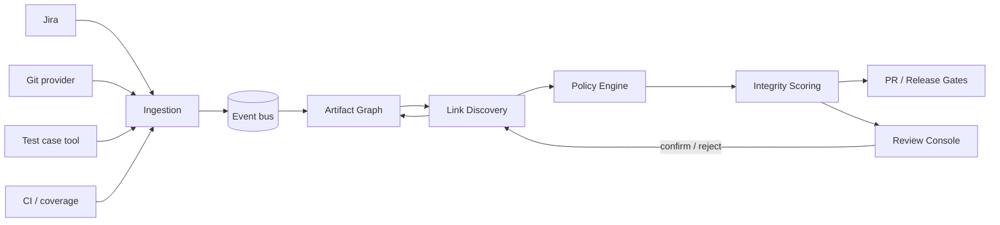
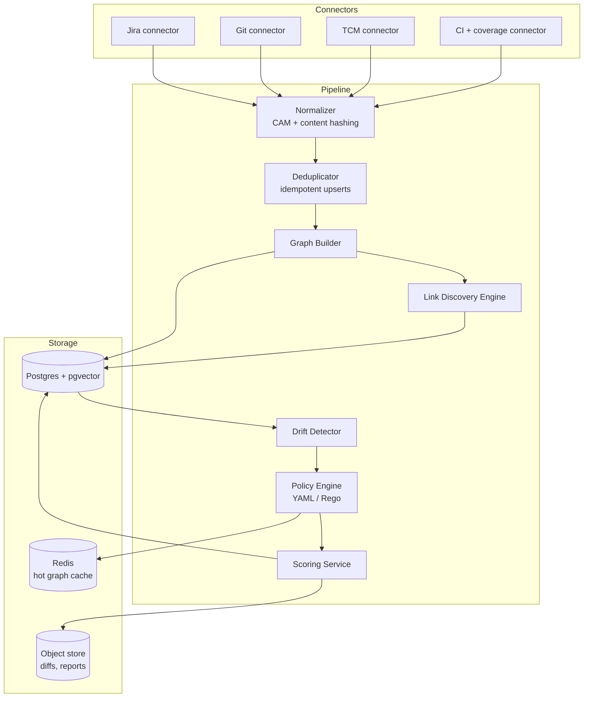
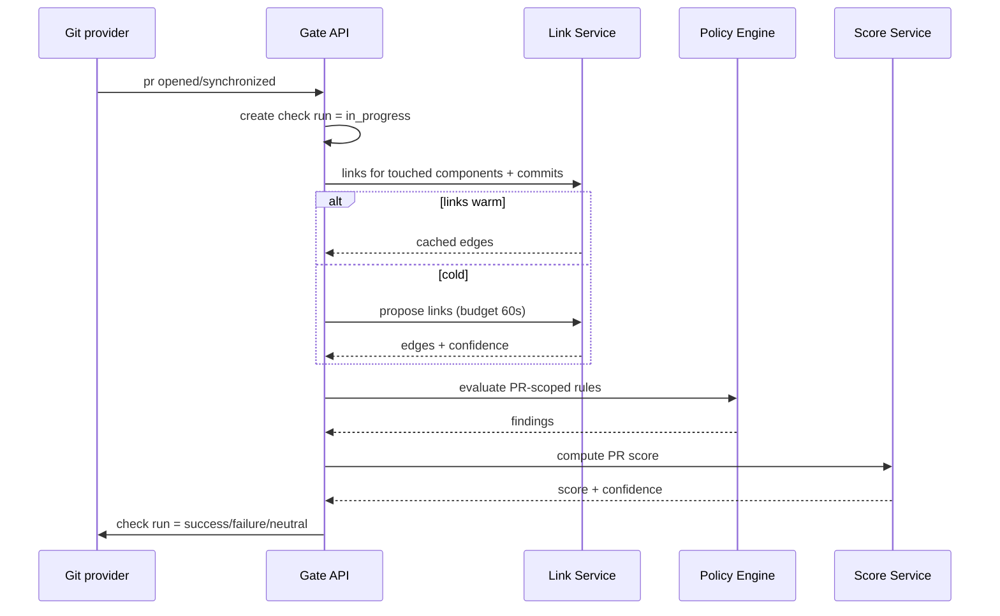

# OPTIMUS — Cross-Artifact Validation System

**System Design · v0.1 draft · designed from scratch for this problem statement**

> This design was authored fresh for the stated goal. No existing product's architecture was used as a template.

---

## 1. Purpose

OPTIMUS answers one question, continuously and for every release:

> *"Do the Jira requirement, the committed code, and the test cases actually describe, implement, and verify the same thing?"*

It ingests three independent systems of record — **Jira**, **Git**, and a **test case maintenance tool (TCM)** — builds a single provenance-aware graph of artifacts, discovers and scores the links between them, and evaluates the graph against versioned policies. The output is an explainable **Integrity Score** plus actionable findings, delivered as a PR check, a release gate, and a dashboard.

The hard problem is not integration. It is that the three systems do not share identifiers, teams edit them at different times, and "linked" is a matter of degree. OPTIMUS is therefore built around a **confidence-bearing link graph** and a **human-confirmed feedback loop**, not around brittle key matching alone.

---

## 2. Scope

### In scope
- Read-only ingestion from Jira, Git providers, TCM, CI results, and coverage reports.
- Canonical normalization of requirements, code changes, test cases, and executions.
- Explicit, structural, semantic, and behavioural link discovery.
- Drift detection when a requirement changes but its tests or code do not.
- Policy evaluation over the graph: linkage, freshness, execution evidence, AC coverage, code–test alignment.
- PR-level checks and release-level readiness gates, with waivers and audit history.
- Human review console for ambiguous links and policy exceptions.

### Non-goals (v1)
- Running tests, owning CI, or acting as a test orchestrator.
- Automatic code modification or test generation.
- Replacing Jira or the TCM; OPTIMUS stores only references and derived state.
- Auto-linking without approval. Inference is always *proposed*; only explicit or human-confirmed links are treated as facts.
- Judging individual developer productivity. Scores attach to releases, components, and artifacts — never to people.

---

## 3. Design principles

| Principle | Consequence |
|---|---|
| **Provenance over assumption** | Every edge knows how it was created, by whom, with what confidence, and from which evidence. |
| **Explicit beats inferred** | Precedence is fixed: confirmed > explicit > structural > behavioural > semantic. Conflicts are findings, not silent overrides. |
| **Confidence is a first-class field** | A link without a confidence value is invalid. Scores propagate link confidence instead of hiding it. |
| **Incremental by default** | A change recomputes only the affected subgraph. Full backfills are explicit operations with quotas. |
| **Explainable failures only** | A failing rule names the artifact, the evidence, and one concrete next action. |
| **Advisory before blocking** | Every new policy ships in shadow → advisory → gating mode. |
| **Code stays where it is** | Source code is analysed in-place/on-prem; only derived facts and, where permitted, signatures/AST summaries leave the boundary. |

---

## 4. Canonical artifact model (CAM)

Every source is normalized into one schema so that policies never branch on vendor.

| Artifact | Key fields |
|---|---|
| `Requirement` | source, external_id, project, type, title, description, **acceptance_criteria[]** (each with stable `ac_id`), status, fix_version, component, updated_at, content_hash |
| `AcceptanceCriterion` | `ac_id` (hash of normalized text), requirement_id, text, ordinal, status |
| `CodeChange` | repo, commit_sha, parents[], author, message, branch, files[{path, additions, deletions, patch_ref}], pr_id, merged_at |
| `CodeSymbol` | repo, symbol_path, kind, signature_hash, owning_component, last_changed_sha |
| `TestCase` | source, external_id, title, preconditions, steps[], expected, priority, suite, component, jira_refs[], updated_at, content_hash, state(active/draft/deprecated) |
| `TestRun` | test_case_id, build_id, status, duration, failure_signature, executed_at, commit_sha |
| `CoverageMap` | commit_sha, test_file → source_file[] (from CI coverage instrumentation) |
| `Release` | project, version, scope (issue JQL equivalent), branch, cutoff |

**Normalization rules.** Text is NFC-normalized, whitespace-collapsed, and stripped of boilerplate ("As a user…"). Acceptance criteria are parsed into discrete items so that each one can carry its own `ac_id` and its own links — this is what makes drift detection precise instead of "the ticket changed".

---

## 5. System context



---

## 6. Component architecture



**Runtime choices.**
- Python/Go services; **Temporal** for connectors-backfill, link recompute, and release scans; Kafka (or Redis Streams for a smaller install) for ingestion events.
- Postgres as the system of record, with **pgvector** for candidate retrieval. A dedicated graph database is deliberately avoided in v1 — recursive CTEs over an indexed edge table handle the subgraphs we need, and one fewer stateful store is one fewer consistency problem. Introduce a graph DB only if traversal depth or query latency proves it.
- Object storage for diffs, JUnit XML, coverage maps, and immutable evaluation reports.
- **ClickHouse** (or partitioned Postgres) for `test_executions` once volume exceeds ~5M rows/day; abstracted behind a `TestExecutionStore` interface so the migration is contained.

---

## 7. Ingestion

| Source | Mechanism | Latency target |
|---|---|---|
| Jira | Webhooks (issue create/update/delete, link events) + scheduled reconcile every 6 h | < 60 s |
| Git | Provider webhooks (push, PR merged) + API backfill for history; no polling in steady state | < 60 s |
| TCM | Webhooks where available; otherwise delta polling on `updated_at` every 5 min | < 5 min |
| CI | Post-build webhook with JUnit + coverage artifacts | < 2 min |

**Exactly-once effects, at-least-once delivery.** Each event carries `(source, source_event_id)`. The normalizer computes `content_hash` per artifact; upserts are keyed by `(source, external_id, content_hash)`, so replays are no-ops and only genuinely new versions create rows. Unparseable events go to a DLQ with the raw payload retained for 14 days.

**Change propagation.** When an artifact version is written, the graph builder enqueues a recompute for the reverse-reachable set (depth ≤ 2, capped at 5,000 nodes, debounced 60 s). Requirement edits therefore re-evaluate only the tests and commits that could plausibly be affected — not the release.

**History, not overwrite.** Artifact versions are append-only. `Requirement@hash`, `TestCase@hash` are immutable rows; "current" is a view. This is what makes drift detection and "who changed what when" possible.

---

## 8. Link discovery engine

The core of OPTIMUS. Links are typed edges between artifacts:

```
Requirement --references--> CodeChange
Requirement --verifies-----> TestCase      (test case verifies requirement)
CodeChange  --touches------> CodeSymbol
CodeSymbol  --covered_by---> TestCase      (derived from coverage + test code)
TestCase    --executed_in--> TestRun
```

Every edge carries `origin ∈ {confirmed, explicit, structural, behavioural, semantic}`, `confidence ∈ [0,1]`, `evidence[]`, `state ∈ {proposed, active, rejected, stale}`.

### 8.1 Cascade

1. **Explicit (confidence 1.0).** Jira key regex in commit message / branch name / PR title; `jira_refs` field in the test case; commit SHA referenced in a test case or test annotation (`@Jira("ABC-123")`).
2. **Structural (0.6–0.85).** Repo↔Jira project mapping, CODEOWNERS/component ownership, fix-version↔release-branch mapping, suite↔component mapping. Links artifacts that share an owner but no key.
3. **Behavioural (0.7–0.9).** Coverage map joins test files to source files; source files are joined to the requirement through commits. This catches "the test verifies this code, and this code implements this story" even with no textual clue.
4. **Semantic (0.3–0.95).** Embedding retrieval + rerank between AC items and test cases (title + steps + expected), and between AC items and code symbols (docstrings/signatures). Candidates retrieved via pgvector ANN; reranked by a gradient-boosted ranker using features: explicit-key match, shared component, path token overlap, cosine similarity, symbol/identifier overlap, same sprint, historical accept rate for the team pair, text overlap.

### 8.2 Decision policy

```
auto_accept   : confidence >= 0.85 AND independent_signal_count >= 2
review_queue  : 0.55 <= confidence < 0.85
discard       : confidence < 0.55
```

- **Multiple independent signals** means, for example, key match *and* shared component — not two flavours of the same text similarity.
- **Precedence on conflict:** confirmed > explicit > structural > behavioural > semantic. If two explicit links contradict (ticket says X, commit says Y), a `LINK_CONFLICT` finding is raised rather than picking a winner.
- **Human decisions are durable.** A confirmed link becomes `origin: confirmed`, confidence 1.0, and is never downgraded by the model. A rejection suppresses the exact pair for 180 days and is fed back as a negative label.

### 8.3 Learning loop
Human confirmations/rejections accumulate per project into a labelled dataset. A per-project re-ranker is retrained weekly once ≥500 decisions exist; until then a global ranker is used. Rollout is shadow-scored against live proposals; a new ranker is promoted only if precision at the auto-accept threshold improves and recall does not drop by more than 2 points.

---

## 9. Drift detection

The failure mode OPTIMUS exists to catch: *a requirement changed, the tests did not.*

1. Each AC item has a stable `ac_id`. On requirement update, the detector diffs AC items into `added / removed / modified`.
2. Each change is **classified** so teams are not spammed by typos:
   - **L0 cosmetic** — whitespace, grammar, no semantic delta. No action.
   - **L1 clarifying** — wording clarified, behaviour unchanged. Notification only.
   - **L2 behavioural** — new or changed behaviour/edge case. Requires an updated or explicitly waived test.
   Classification uses embedding distance plus an LLM semantic diff that must return structured added/removed behaviour claims — never a free-form summary.
3. For every L2 change, the detector walks `Requirement → TestCase` edges and checks whether linked tests were updated **at or after** the requirement's change time.
4. Result: `TEST_STALE` findings per AC item, with the capability to distinguish "no test at all" from "test exists but predates the change".

A test is **stale** if `test.updated_at < requirement_version.updated_at` *and* the change is L2. A test is **missing** if the AC item has no active verifying link. These are different findings with different severities — the distinction is what makes the output trustworthy.

---

## 10. Policy engine

Policies are versioned, per-project, and written as code (YAML with an embedded expression language, or Rego for complex cases). Each rule evaluates against the graph and returns findings; the score is computed from findings in code.

```yaml
policy: release-integrity
version: 7
rules:
  - id: LNK-001
    severity: blocker
    weight: 3
    assert: every_in_scope_requirement has_active_link to code
    message: "Requirement is not implemented by any merged commit in this release."

  - id: LNK-004
    severity: major
    weight: 2
    assert: no orphan_commit in release_branch
    message: "Commit is not linked to any requirement."

  - id: DRF-002
    severity: blocker
    weight: 3
    assert: for_each L2_change, all_verifying_tests.updated_at >= change.at
    message: "Acceptance criterion changed after its tests were last updated."

  - id: EXE-001
    severity: major
    weight: 2
    assert: last_3_builds.test_pass_rate >= 0.95
    message: "Linked tests are not passing in recent builds."

  - id: COV-003
    severity: major
    weight: 2
    risk_weighted: true
    assert: ac_coverage_ratio >= 0.90
    message: "Risk-weighted acceptance criterion coverage below threshold."

  - id: INT-001
    severity: minor
    weight: 1
    assert: test_case.assertion_count_delta >= 0
    message: "Assertions were removed from a linked test in the same commit as source changes."
```

Severity resolution: `blocker` fails the release; `major` requires waiver; `minor` is report-only. Waivers require owner, reason, expiry (≤ 30 days), and appear in every gate report.

---

## 11. Scores and gates

### 11.1 Integrity score

```
dimensions = {
  linkage      : 0.25,
  ac_coverage  : 0.25,
  execution    : 0.20,
  freshness    : 0.15,
  code_test    : 0.15
}

dimension_score = Σ wᵣ·oᵣ / Σ wᵣ            (oᵣ ∈ [0,1], unknown excluded)
integrity       = 100 · Σ Wd · dimension_score_d
confidence      = weighted mean of link confidence over all edges used
```

Grade bands: **90–100 Verified**, **75–89 Acceptable**, **60–74 At risk**, **< 60 Unverified**, plus **Unverified-by-data** when coverage of evidence is below 60%.

Scores decompose: every point is attributable to a rule, which is attributable to an artifact, which is attributable to evidence. The console shows this drill-down for any release.

### 11.2 PR gate

Delivered as a provider Check Run (`neutral` while pending, `success`/`failure` on completion, `neutral` on infrastructure error — never a false block). Budget: 90 seconds. If analysis exceeds the budget, post `neutral` with `pending_analysis: true` and update asynchronously.

Checks scoped to the PR: orphan commits, requirement links for touched components, stale tests for changed behaviour, assertion-removal heuristics, and coverage delta on changed lines.

### 11.3 Release gate

```
PASS when ALL of:
  - LNK-001, DRF-002 void: no blocker findings in scope
  - integrity >= 75
  - p10 requirement integrity >= 55
  - risk-weighted AC coverage >= 0.90
  - pass rate over last 3 builds >= 0.95
  - every failure has an active, unexpired waiver
  - link confidence mass >= 0.80 (no "passing" release built on guesses)
```

The last condition is the one most systems omit: a release must not pass because OPTIMUS could not tell what was linked. Unknown is not green.

---

## 12. Suspicious pattern detection

Run as a separate, advisory-only rule family, because false positives here are expensive:

| Pattern | Signal |
|---|---|
| Test weakening | Assertions removed, `skip`/`xfail`/`only` added, timeout raised, try/catch widened, mocks introduced around the unit under test, snapshot regenerated — in the same commit as source changes |
| Coverage gaming | New source lines excluded from coverage config; test doubles replacing integration paths |
| Commit hygiene | Force-push to release branch, direct commit bypassing PR, commit message stripped of ticket key |
| Execution theatre | Test case marked passed without a corresponding execution record |
| Link stuffing | Explicit key references added to unrelated commits after the fact (detected by timing + diff irrelevance) |

Each produces a `risk_score` and a `SUSPICIOUS_CHANGE` finding; gateable per project only after the team sees the signal in advisory mode for two releases.

---

## 13. Data model (core tables)

```sql
source_systems(id, kind, base_url, credential_ref, tenant_id, config jsonb)
artifacts(id, source_system_id, external_id, kind, content_hash, first_seen_at, last_seen_at)
artifact_versions(id, artifact_id, content_hash, payload jsonb, valid_from, valid_to)
requirements(artifact_id PK, project, type, title, status, fix_version, component,
             ac_items jsonb, updated_at)
test_cases(artifact_id PK, suite, component, priority, steps jsonb, expected,
           jira_refs jsonb, state, updated_at)
code_changes(artifact_id PK, repo, commit_sha, parents text[], pr_id, branch,
             files jsonb, merged_at)
artifact_edges(id, src_id, dst_id, kind, origin, confidence, state,
               evidence jsonb, created_by, created_at, superseded_by)
link_decisions(id, src_id, dst_id, decision, actor, reason, created_at)
link_candidates(id, src_id, dst_id, score, features jsonb, model_version, created_at)
policies(id, project_id, version, mode, spec jsonb, activated_at, retired_at)
evaluations(id, scope, scope_ref, policy_id, inputs_hash, score, dimensions jsonb,
            findings jsonb, confidence, created_at)
findings(id, evaluation_id, rule_id, severity, artifact_ref, evidence jsonb, status)
waivers(id, rule_id, artifact_ref, owner, reason, expires_at, revoked_at)
test_executions(id, test_case_id, build_id, commit_sha, status, executed_at,
                duration_ms, failure_signature)  -- partition by month
coverage_maps(id, commit_sha, test_path, source_paths text[])
sync_cursors(source_system_id, cursor, updated_at)
```

Indexes: `(src_id, kind)`, `(dst_id, kind)`, partial index on `artifact_edges(state) WHERE state='active'`, GIN on `ac_items`, HNSW on embeddings, BRIN on `test_executions(executed_at)`.

---

## 14. API surface

```
POST /v1/artifacts                      -> upsert normalized artifact (internal)
GET  /v1/requirements/{id}/graph?depth=2
GET  /v1/tests/{id}/links
POST /v1/links/{id}/confirm             -> promote proposal to confirmed
POST /v1/links/{id}/reject              -> suppress pair + negative label
GET  /v1/review-queue?project=...       -> ranked proposals awaiting decision
POST /v1/policies                       -> create draft version
POST /v1/policies/{id}/mode             -> shadow | advisory | gating
POST /v1/gates/pr                       -> {repo, pr, base_sha, head_sha} -> check result (≤ 90 s)
GET  /v1/gates/pr/{check_id}
POST /v1/releases/{project}/{version}/evaluate -> 202 {evaluation_id}
GET  /v1/evaluations/{id}               -> score, dimensions, findings, provenance
POST /v1/waivers | DELETE /v1/waivers/{id}
GET  /v1/reports/{id}.json              -> signed immutable report
GET  /v1/health, /v1/metrics
```

All endpoints are tenant-scoped; artifacts from a tenant region never cross regions.

---

## 15. Key flows

### 15.1 PR gate



### 15.2 Release evaluation

1. Resolve scope (Jira version + release branch) into artifact IDs.
2. Ensure ingestion cursors are caught up; record the exact watermark in the report.
3. Snapshot the subgraph (`inputs_hash`) so the evaluation is reproducible.
4. Run policy rules → findings; compute dimensions and integrity score.
5. Persist immutable report; publish gate result and drill-down link.
6. Diff against the previous run to surface regressions ("3 new stale tests since last night").

---

## 16. Non-functional requirements

| Area | Target |
|---|---|
| Ingestion → graph visibility | p95 ≤ 45 s |
| Link proposal for a new commit | p95 ≤ 3 min |
| PR gate response | p95 ≤ 60 s, hard timeout 90 s |
| Release evaluation (5k artifacts) | ≤ 8 min |
| Availability | 99.9% gate API, 99.5% console |
| Throughput | 3k commits/day, 20k test executions/day, 150k requirements per install |
| Durability | No lost events; replayable from 30-day event retention |

---

## 17. Failure modes & degradation

| Failure | Behaviour |
|---|---|
| Jira/Git/TCM outage | Serve cached graph with `data_freshness` watermark; gates return `neutral` if watermark exceeds the policy limit (default 2 h). Never fail a release on stale data. |
| Link service slow | PR gate uses cached edges; unresolved candidates become `unknown`, not failures. |
| Ambiguous links | Excluded from scoring numerator and denominator, counted in `confidence`; gate can fail on the confidence floor instead of inventing a verdict. |
| Event storm after a bulk import | Backpressure with per-source token bucket; link recompute collapses into a single batch per subgraph. |
| Policy bug | Policies are versioned and evaluated in shadow before promotion; a bad version can be retired instantly and the previous version re-run. |
| Coverage map missing | `code_test` dimension becomes `unknown`; score is reported with reduced coverage and the gate falls back to linkage + execution evidence. |

---

## 18. Security & privacy

- **Least privilege**: read-only tokens per source by default. Writes are limited to check runs and, if enabled, posting a link annotation — never editing Jira issues or test cases.
- **Code never leaves the boundary**: semantic matching sends requirement text and test steps, not source. Where code context is needed, only symbol signatures and docstrings are summarised locally. A "no-code-egress" mode disables even that and falls back to structural + behavioural signals with a self-hosted embedding model.
- **Tenant and repo isolation**: ACLs mirrored from Git/TCM per project; results are only visible to users with access to the underlying repo.
- **Secret hygiene**: pre-storage scanning drops credentials accidentally committed in diffs; object store is encrypted with per-tenant keys.
- **Auditability**: immutable reports include inputs hash, policy version, model/ranker version, connector watermarks, and the full finding set — enough to reproduce any gate decision.

---

## 19. Observability

**Dashboards**
- Ingestion lag per source, event backlog, DLQ depth.
- Link quality: auto-accept precision (sampled audit), review-queue acceptance rate, proposal latency.
- Graph health: orphan rate, conflict rate, edges by origin, confidence distribution.
- Gate health: pass/fail/neutral ratio, p95 latency, timeout rate.
- Score movement: release integrity trend, dimension deltas, waiver count.

**Alerts**: ingestion lag > 15 min, DLQ > 100 events, gate timeout > 2%, auto-accept precision < 0.9 on sampled audit, confidence mass drop > 10 points release-over-release.

**Precision auditing** is a feature, not an afterthought: every week a stratified random sample of auto-accepted links is sent to reviewers. This is the only honest way to claim the graph is trustworthy.

---

## 20. Deployment, sizing, rollout

- Stateless services behind a queue; Temporal workers scale on backlog. Postgres primary + read replica; pgvector index sized for the requirement/test corpus.
- Sizing baseline (single install): 200 repos, 150k requirements, 300k test cases, 3k commits/day, 20k executions/day → ~4 vCPU / 16 GB for services, ~8 vCPU / 32 GB for Postgres, object store sized for 90 days of diffs and reports.
- **Rollout**: shadow mode (compute, no gates) for 4 weeks → advisory checks → gating for 2 pilot repos → progressive. Gate enablement is per project, never global by default.

---

## 21. Test strategy

| Layer | Approach |
|---|---|
| Normalizer | Golden fixtures per connector; idempotent replay produces zero new rows. |
| Link engine | Labelled pair dataset per project; precision@auto-accept and recall@0.55 are release gates. |
| Drift classifier | L0/L1/L2 labelled corpus; measure false-"behavioural" rate (noise) as the primary metric. |
| Policy engine | Rule fixtures with expected findings; determinism test on a frozen graph snapshot. |
| Scoring | Property tests: score monotonic in each dimension, unknown exclusion, confidence floor behaviour. |
| Gates | Contract tests against provider check-run API, including timeout → `neutral`. |
| End-to-end | Replay a full release from recorded events and assert the report is byte-identical (given same inputs hash). |

---

## 22. Key decisions

| # | Decision | Alternatives considered | Why |
|---|---|---|---|
| D1 | Link graph in Postgres, not a graph DB | Neo4j | Traversals are shallow; one fewer distributed store; recursive CTEs suffice; migration path stays open behind a repository interface |
| D2 | Confidence-bearing edges with fixed precedence | Boolean links | Reality is ambiguous; encoding that explicitly prevents both false failures and false passes |
| D3 | Inference is proposal-only | Auto-link everything | Auto-links mutate downstream systems and destroy trust on first error |
| D4 | Drift classified L0–L2 | Alert on any ticket change | Alert fatigue is the top adoption killer; cosmetic edits must be silent |
| D5 | Gate returns `neutral` on infra failure | Fail closed | A validation tool that blocks work during its own outage gets removed |
| D6 | Sample-based precision auditing | Trust the model | Provides a measurable, defensible quality claim |
| D7 | Append-only artifact versions | Mutable current-state rows | Required for drift semantics and reproducible reports |

---

## 23. Boundary with JRVS

JRVS judges **ticket quality**; OPTIMUS judges **cross-artifact traceability**. They are independently deployable and share nothing at runtime. If both are adopted, OPTIMUS may optionally consume JRVS's published evaluation as one additional signal in the `linkage` dimension — a read-only, cacheable call, never a hard dependency. Neither system blocks on the other.

---

## 24. Assumptions & open questions

**Assumptions**
- Jira keys are used somewhere in Git history or PR metadata for most work; explicit links are the backbone and inference fills gaps.
- The TCM exposes test case content and execution results through an API or webhook.
- Teams accept periodic review-queue triage as the price of trustworthy links (≈ 10–20 decisions/day at pilot scale).
- Coverage instrumentation exists or can be added to CI.

**Open questions**
1. Should OPTIMUS write confirmed links back into Jira/TCM, and if so, which side is authoritative?
2. What is the policy for monorepos where one commit spans many requirements but only one key is in the message?
3. Do we treat deleted tests as findings, waivers, or coverage loss only?
4. How much historical backfill is worth the embedding cost at onboarding — 90 days or full history?
5. Who owns the per-project policy: QA lead, engineering manager, or a platform team?

---

## 25. Roadmap

| Phase | Deliverable |
|---|---|
| **P0 (6–8 wks)** | Jira + Git connectors, CAM, artifact versions, explicit + structural links, graph API, read-only console. |
| **P1** | TCM + CI ingestion, execution evidence, drift detection with AC-level IDs, policy engine, release report (advisory). |
| **P2** | Semantic/behavioural links, review queue, PR gate, confidence propagation, waivers. |
| **P3** | Learning loop, suspicious-pattern detection, coverage-aware risk weighting, cross-release trend analytics. |
